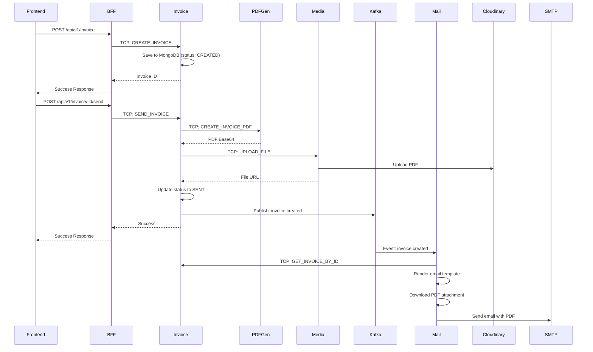

# 📋 Phân Tích Kiến Trúc Hệ Thống Invoice Microservices

## 🎯 Tổng Quan Dự Án

Đây là một hệ thống **E-Invoice (Hóa Đơn Điện Tử)** được xây dựng theo kiến trúc **Microservices** sử dụng **NestJS**, **MongoDB**, **Kafka**, và **Docker**. Hệ thống được tổ chức theo mô hình **Nx Monorepo** để quản lý nhiều ứng dụng và thư viện dùng chung.

### 🏗️ Kiến Trúc Tổng Thể

```
┌─────────────────────────────────────────────────────────────────┐
│                        CLIENT LAYER                             │
├─────────────────────────────────────────────────────────────────┤
│                    BFF (Backend for Frontend)                   │
│                         Port: 3000                              │
├─────────────────────────────────────────────────────────────────┤
│                      MICROSERVICES LAYER                        │
│  ┌─────────────┬─────────────┬─────────────┬─────────────────┐  │
│  │   Invoice   │    Mail     │   Media     │  PDF Generator  │  │
│  │  Port:3001  │ Port:3004   │ Port:3002   │   Port:3003     │  │
│  └─────────────┴─────────────┴─────────────┴─────────────────┘  │
│  ┌─────────────┬─────────────────────────────────────────────┐  │
│  │ User Access │           Authorizer                        │  │
│  │ Port:3005   │           Port:3006                         │  │
│  └─────────────┴─────────────────────────────────────────────┘  │
├─────────────────────────────────────────────────────────────────┤
│                    INFRASTRUCTURE LAYER                         │
│           MongoDB        Kafka         Docker Network           │
│          Port:27017    Port:9092        einvoice-nw            │
└─────────────────────────────────────────────────────────────────┘
```

## 🏢 Phân Tích Từng Microservice

### 1. 🌐 **BFF (Backend for Frontend)** - Port 3000
**Vai trò**: API Gateway và điểm tập trung cho frontend
**Công nghệ**: NestJS + Express + Swagger

**Đặc điểm chính**:
- Cung cấp REST API cho frontend
- Tích hợp Swagger documentation tại `/api/v1/docs`
- Sử dụng TCP client để giao tiếp với các microservices
- Validation toàn cục với `ValidationPipe`
- CORS được enable cho tất cả origins

**Modules**:
- `ProductModule`: Quản lý sản phẩm
- `InvoiceModule`: Quản lý hóa đơn  
- `UserModule`: Quản lý người dùng

### 2. 📄 **Invoice Service** - Port 3001
**Vai trò**: Core business logic cho hóa đơn
**Công nghệ**: NestJS + MongoDB + Kafka Producer

**Business Logic chính**:
```typescript
// Luồng tạo và gửi hóa đơn
1. Create Invoice (status: CREATED)
2. Update Invoice (chỉ khi status = CREATED)
3. Send Invoice:
   - Generate PDF via PDF Generator Service
   - Upload file via Media Service  
   - Update status to SENT
   - Emit Kafka event: invoice.created
```

**Modules**:
- `InvoiceModule`: CRUD hóa đơn
- `ProductModule`: Quản lý sản phẩm
- `KafkaModule`: Producer cho events

### 3. 📧 **Mail Service** - Port 3004
**Vai trò**: Xử lý gửi email và Kafka consumer
**Công nghệ**: NestJS + Nodemailer + Kafka Consumer

**Event-Driven Processing**:
```typescript
// Kafka Consumer Flow
invoice.created event → MailInvoiceService.sendInvoiceCreated()
├── Lấy thông tin hóa đơn từ Invoice Service (TCP)
├── Render email template với EJS
├── Download PDF attachment từ URL
└── Gửi email với attachment
```

### 4. 📁 **Media Service** - Port 3002
**Vai trò**: Quản lý file upload/storage
**Công nghệ**: NestJS + Cloudinary + Multer

**Chức năng**:
- Upload file base64 lên Cloudinary
- Trả về public URL
- Hỗ trợ multiple file formats

### 5. 📄 **PDF Generator Service** - Port 3003
**Vai trò**: Tạo PDF từ template
**Công nghệ**: NestJS + Puppeteer + EJS

**Process**:
- Nhận data hóa đơn
- Render HTML template với EJS
- Convert HTML to PDF với Puppeteer
- Trả về PDF dưới dạng base64

### 6. 👤 **User Access Service** - Port 3005
**Vai trò**: Quản lý người dùng và phân quyền
**Modules**: UserModule với CRUD operations

### 7. 🔐 **Authorizer Service** - Port 3006
**Vai trò**: Authentication và Authorization
**Công nghệ**: JWT + JWKS

## 📚 Shared Libraries (libs/)

### 🔧 **Core Libraries**:

1. **`@common/schemas`**: MongoDB Schemas
   ```typescript
   // Base Schema với common fields
   export class BaseSchema {
     _id: ObjectId;
     id: string; // Virtual field
     createdAt: Date;
     updatedAt: Date;
   }
   
   // Invoice Schema
   export class Invoice extends BaseSchema {
     client: Client;
     totalAmount: number;
     vatAmount: number;
     status: INVOICE_STATUS; // CREATED | SENT | VERIFIED
     items: Item[];
     supervisorId?: ObjectId;
     fileUrl?: string;
   }
   ```

2. **`@common/queue`**: Kafka Integration
   ```typescript
   // Dynamic Kafka Module
   KafkaModule.forProducerAsync({ serviceName: KAFKA_SERVICES.INVOICE })
   KafkaModule.forConsumerAsync({ 
     groupId: KAFKA_GROUPS.MAIL, 
     serviceName: KAFKA_SERVICES.MAIL 
   })
   ```

3. **`@common/middlewares`**: Request Logging
   - `LoggerMiddleware`: Log request/response với processID
   - Tracking duration và error handling

4. **`@common/interceptors`**: Global Error Handling
   - `ExceptionInterceptor`: Standardized error response
   - `TcpLoggingInterceptor`: TCP request logging

5. **`@common/interfaces`**: Type Definitions
   - Gateway DTOs (REST API)
   - TCP Request/Response types
   - Queue payload types

## 🔄 Communication Patterns

### 1. **Synchronous Communication** (TCP)
```typescript
// BFF → Invoice Service
this.invoiceClient.send<string, CreateInvoiceTcpReq>(
  TCP_REQUEST_MESSAGE.INVOICE.CREATE, 
  { data: body, processID }
)

// Invoice Service → PDF Generator
this.pdfGeneratorClient.send<string, InvoiceTcpResponse>(
  TCP_REQUEST_MESSAGE.PDF_GENERATOR.CREATE_INVOICE_PDF,
  { data, processID }
)
```

### 2. **Asynchronous Communication** (Kafka)
```typescript
// Producer (Invoice Service)
this.KafkaClient.send<InvoiceCreatedPayload>(
  KAFKA_TOPICS.INVOICE.CREATED, 
  { id }
)

// Consumer (Mail Service) - Implicit handling
// KafkaModule.forConsumerAsync tự động subscribe topics
```

## 🏛️ Architectural Patterns Được Áp Dụng

### 1. **Microservices Architecture**
- **Độc lập**: Mỗi service có database và logic riêng
- **Scalability**: Scale từng service theo nhu cầu
- **Technology diversity**: Có thể dùng tech stack khác nhau

### 2. **Event-Driven Architecture**
- **Kafka**: Async communication giữa services
- **Loose coupling**: Services không phụ thuộc trực tiếp
- **Resilience**: Failure của một service không ảnh hưởng khác

### 3. **API Gateway Pattern (BFF)**
- **Single entry point**: Frontend chỉ gọi BFF
- **Request routing**: BFF route request đến đúng service
- **Cross-cutting concerns**: Authentication, logging, validation

### 4. **Repository Pattern**
```typescript
// Clean separation of data access logic
@Injectable()
export class InvoiceRepository {
  constructor(@InjectModel(InvoiceModelName) private model: InvoiceModel) {}
  
  create(input: CreateInvoiceInput) {
    return this.model.create(input);
  }
  
  paginate(params: PaginateInvoiceTcpReq) {
    return this.model.paginate({}, params);
  }
}
```

### 5. **Dependency Injection**
- NestJS built-in DI container
- Loose coupling giữa components
- Easy testing và mocking

## 🛠️ Best Practices Được Implement

### 1. **Configuration Management**
```typescript
// Centralized configuration
ConfigModule.forRoot({
  isGlobal: true,
  load: [() => ({ ...CONFIGURATION })],
})
```

### 2. **Validation & DTOs**
```typescript
// Input validation với class-validator
export class CreateInvoiceRequestDto {
  @IsNotEmpty()
  client: ClientRequestDto;
  
  @IsArray()
  @ValidateNested({ each: true })
  items: ItemRequestDto[];
}
```

### 3. **Error Handling**
- Global exception interceptor
- Standardized error response format
- Process ID tracking cho debugging

### 4. **Logging & Monitoring**
- Request/response logging với duration
- Process ID để trace request flow
- Structured logging format

### 5. **Database Design**
- Base schema với common fields
- Virtual fields (id from _id)
- Pagination support với mongoose-paginate-v2

### 6. **Security**
- JWT authentication
- CORS configuration
- Input validation

## 🔄 Business Flow Example

### Luồng Tạo và Gửi Hóa Đơn:



## 🧪 Khái Niệm Cần Hiểu Trước Khi Học

### 1. **NestJS Fundamentals**
- Decorators (@Injectable, @Controller, @Module)
- Dependency Injection
- Pipes, Interceptors, Guards, Middleware
- Microservices với @MessagePattern

### 2. **MongoDB & Mongoose**
- Schema definition
- Virtuals và toJSON transforms
- Pagination với mongoose-paginate-v2
- ObjectId references

### 3. **Message Queues**
- Kafka concepts: Topics, Producers, Consumers, Groups
- Event-driven architecture
- Async vs Sync communication

### 4. **Docker & Containerization**
- Multi-container applications
- Docker networking
- Environment configuration

### 5. **TypeScript Advanced**
- Generics và Type constraints
- Utility types (Pick, Omit, Partial)
- Interface segregation

## 🚀 Bài Tập Thực Hành

### **Bài 1: Extend Invoice Status**
Thêm trạng thái `CANCELLED` cho hóa đơn:
1. Update `INVOICE_STATUS` enum
2. Thêm endpoint `PATCH /invoice/:id/cancel`
3. Implement business logic validation
4. Thêm Kafka event `invoice.cancelled`
5. Mail service xử lý gửi email thông báo hủy

### **Bài 2: Implement Product Service**
Tách Product logic thành microservice riêng:
1. Tạo Product Service (port 3007)
2. Move product logic từ Invoice Service
3. Update BFF để route product requests
4. Implement product validation khi tạo invoice

### **Bài 3: Add Authentication**
Tích hợp JWT authentication:
1. Implement JWT Guard trong BFF
2. Add user context vào request
3. Implement role-based authorization
4. Secure TCP communication giữa services

### **Bài 4: Monitoring & Health Checks**
Thêm monitoring capabilities:
1. Health check endpoints cho tất cả services
2. Metrics collection (Prometheus format)
3. Distributed tracing với correlation ID
4. Error rate và performance monitoring

### **Bài 5: Event Sourcing Pattern**
Implement event sourcing cho Invoice:
1. Lưu tất cả events thay vì chỉ state hiện tại
2. Rebuild state từ event stream
3. Implement event replay functionality
4. Add snapshot mechanism cho performance

## 🔧 Gợi Ý Cải Tiến

### 1. **Performance Optimization**
- Implement caching với Redis
- Database indexing strategy
- Connection pooling configuration
- Async processing với Bull Queue

### 2. **Security Enhancement**
- API rate limiting
- Input sanitization
- Audit logging
- Secret management với Vault

### 3. **Observability**
- Distributed tracing với Jaeger
- Centralized logging với ELK stack
- Application metrics với Prometheus + Grafana
- Alert management

### 4. **Resilience Patterns**
- Circuit breaker pattern
- Retry mechanism với exponential backoff
- Timeout configuration
- Graceful shutdown handling

### 5. **Testing Strategy**
- Unit tests cho business logic
- Integration tests cho API endpoints
- Contract testing giữa services
- End-to-end testing với Docker Compose

## 📖 Tài Liệu Tham Khảo

- [NestJS Documentation](https://docs.nestjs.com/)
- [Nx Monorepo Guide](https://nx.dev/getting-started/intro)
- [Kafka with Node.js](https://kafka.js.org/)
- [MongoDB Best Practices](https://docs.mongodb.com/manual/administration/production-notes/)
- [Microservices Patterns](https://microservices.io/patterns/)

---

**Lưu ý**: Đây là một hệ thống production-ready với nhiều best practices được áp dụng. Học viên nên thực hành từng phần nhỏ trước khi hiểu toàn bộ hệ thống.