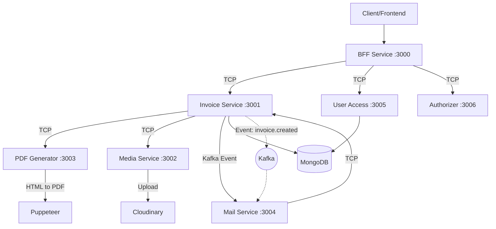
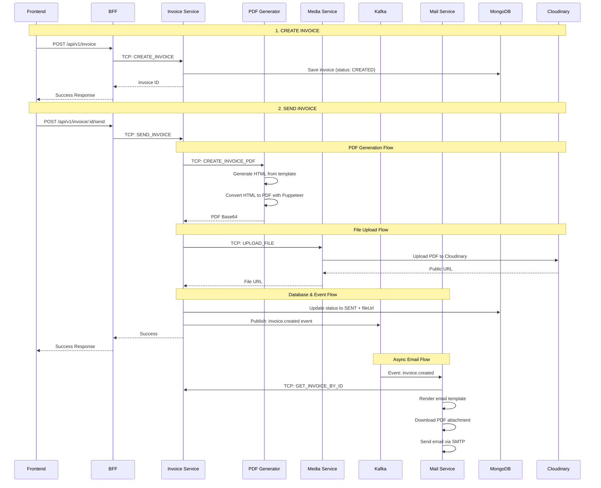
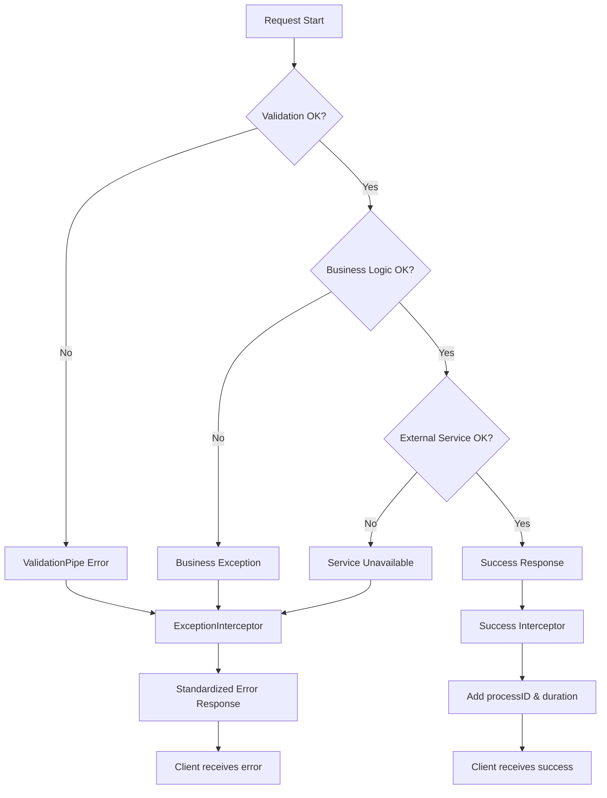

# 📚 Tài Liệu Giảng Dạy: Hệ Thống E-Invoice Microservices

## 🎯 Giới Thiệu Khóa Học

Chào mừng các bạn đến với khóa học **"Xây Dựng Hệ Thống E-Invoice với Microservices Architecture"**. Khóa học này sẽ hướng dẫn các bạn phân tích và hiểu sâu một hệ thống thực tế được xây dựng bằng **NestJS**, **MongoDB**, **Kafka**, và **Docker**.

### 🎓 Đối Tượng Học Viên
- Đã có kiến thức cơ bản về **NestJS**, **MongoDB**, **TypeScript**
- Hiểu biết về **REST API** và **HTTP Protocol**
- Có kinh nghiệm với **Docker** cơ bản
- Muốn học về **Microservices Architecture** và **Event-Driven Design**

### 🏆 Mục Tiêu Học Tập
Sau khóa học, học viên sẽ:
1. Hiểu rõ kiến trúc **Microservices** và **Event-Driven Architecture**
2. Nắm vững cách thiết kế và implement **API Gateway Pattern** (BFF)
3. Biết cách sử dụng **Kafka** cho async communication
4. Áp dụng được các **Design Patterns**: Repository, DI, Factory
5. Implement được **Error Handling**, **Logging**, **Validation** trong microservices
6. Thiết kế database schema với **MongoDB** và **Mongoose**

---

## 🏗️ PHẦN 1: TỔNG QUAN KIẾN TRÚC

### 1.1 Kiến Trúc Tổng Thể

Hệ thống được thiết kế theo mô hình **Microservices Architecture** với **Nx Monorepo**, bao gồm:

```
📦 E-Invoice System
├── 🌐 BFF (Backend for Frontend) - Port 3000
├── 📄 Invoice Service - Port 3001  
├── 📁 Media Service - Port 3002
├── 📄 PDF Generator Service - Port 3003
├── 📧 Mail Service - Port 3004
├── 👤 User Access Service - Port 3005
├── 🔐 Authorizer Service - Port 3006
├── 🗄️ MongoDB - Port 27017
└── 📨 Kafka - Port 9092
```

### 1.2 Mô Hình Giao Tiếp



### 1.3 Technology Stack

| Layer | Technology | Purpose |
|-------|------------|---------|
| **Framework** | NestJS | Microservices framework |
| **Language** | TypeScript | Type-safe development |
| **Database** | MongoDB + Mongoose | Document database |
| **Message Queue** | Kafka | Event-driven communication |
| **File Storage** | Cloudinary | Media file storage |
| **PDF Generation** | Puppeteer + EJS | PDF creation |
| **Email** | Nodemailer | Email delivery |
| **Containerization** | Docker + Docker Compose | Deployment |
| **Monorepo** | Nx | Code organization |

---

## 🧩 PHẦN 2: PHÂN TÍCH TỪNG MICROSERVICE

### 2.1 🌐 BFF (Backend for Frontend) Service

**📍 Vai trò**: API Gateway - điểm tập trung cho frontend

#### 2.1.1 Cấu Trúc Project
```
apps/bff/
├── src/
│   ├── main.ts              # Entry point
│   ├── app/
│   │   ├── app.module.ts    # Root module
│   │   └── modules/
│   │       ├── invoice/     # Invoice endpoints
│   │       ├── product/     # Product endpoints  
│   │       └── user/        # User endpoints
│   └── configuration/       # BFF-specific config
```

#### 2.1.2 Điểm Nổi Bật

**🔧 Main.ts Configuration:**
```typescript
// apps/bff/src/main.ts
async function bootstrap() {
  const app = await NestFactory.create<NestExpressApplication>(AppModule);
  
  // Global Configuration
  app.enableCors({ origin: '*' });
  app.useBodyParser('json', { limit: '20mb' });
  app.setGlobalPrefix(globalPrefix);
  app.useGlobalPipes(new ValidationPipe({ transform: true }));
  
  // Swagger Documentation
  const config = new DocumentBuilder()
    .setTitle('E-bff API')
    .addBearerAuth() // JWT Authentication
    .build();
  SwaggerModule.setup(`${globalPrefix}/docs`, app, documentFactory);
}
```

**🎯 Học viên cần chú ý:**
- **Hot Module Replacement** cho development
- **Global Validation Pipe** cho input validation
- **Swagger Integration** cho API documentation
- **CORS Configuration** cho cross-origin requests

#### 2.1.3 Module Structure

**App Module:**
```typescript
// apps/bff/src/app/app.module.ts
@Module({
  imports: [
    ConfigModule.forRoot({ isGlobal: true }),
    ProductModule,
    InvoiceModule, 
    UserModule,
  ],
  providers: [
    {
      provide: APP_INTERCEPTOR,
      useClass: ExceptionInterceptor, // Global error handling
    },
  ],
})
export class AppModule implements NestModule {
  configure(consumer: MiddlewareConsumer) {
    consumer.apply(LoggerMiddleware).forRoutes('*'); // Global logging
  }
}
```

**Invoice Controller Example:**
```typescript
// apps/bff/src/app/modules/invoice/controllers/invoice.controller.ts
@ApiTags('Invoice')
@Controller('invoice')
export class InvoiceController {
  constructor(
    @Inject(TCP_SERVICES.INVOICE_SERVICE) 
    private readonly invoiceClient: TcpClient
  ) {}

  @Post()
  @ApiOkResponse({ type: ResponseDto<string> })
  create(@Body() body: CreateInvoiceRequestDto, @ProcessID() processID: string) {
    return this.invoiceClient
      .send<string, CreateInvoiceTcpReq>(TCP_REQUEST_MESSAGE.INVOICE.CREATE, {
        data: body,
        processID,
      })
      .pipe(map((data) => new ResponseDto(data)));
  }
}
```

**💡 Best Practices được áp dụng:**
1. **API Gateway Pattern**: Tập trung tất cả API endpoints
2. **TCP Communication**: Giao tiếp đồng bộ với microservices
3. **Process ID Tracking**: Theo dõi request flow
4. **DTO Validation**: Input validation với class-validator
5. **Swagger Documentation**: Auto-generated API docs

---

### 2.2 📄 Invoice Service (Core Business Logic)

**📍 Vai trò**: Xử lý logic nghiệp vụ chính của hóa đơn

#### 2.2.1 Cấu Trúc Module
```
apps/invoice/src/app/modules/invoice/
├── controllers/
│   └── invoice.controller.ts    # TCP Message handlers
├── services/
│   └── invoice.service.ts       # Business logic
├── repositories/
│   └── invoice.repository.ts    # Data access layer
└── mappers/
    └── index.ts                 # Data transformation
```

#### 2.2.2 Business Logic Flow

**🔄 Invoice Lifecycle:**
```typescript
// apps/invoice/src/app/modules/invoice/services/invoice.service.ts

export class InvoiceService {
  // 1. Create Invoice (status: CREATED)
  create(params: CreateInvoiceTcpReq) {
    const input = invoiceRequestMapping(params);
    return this.invoiceRepository.create(input);
  }

  // 2. Send Invoice (Complex business flow)
  async sendById(id: string, processID: string) {
    const invoice = await this.getById(id);
    
    // Business rule validation
    if (invoice.status !== INVOICE_STATUS.CREATED) {
      throw new BadRequestException(ERROR_CODE.INVOICE_CAN_NOT_BE_SENT);
    }

    // Generate PDF via PDF Generator Service
    const pdfBase64 = await this.generatorInvoicePdf(
      { ...invoice.toObject(), status: INVOICE_STATUS.SENT }, 
      id
    );
    
    // Upload file via Media Service
    const pdfUrl = await this.uploadFile(
      { fileBase64: pdfBase64, fileName: `invoice-${id}` }, 
      processID
    );

    // Update invoice status
    const invoiceSent = await this.invoiceRepository.updateById(id, {
      status: INVOICE_STATUS.SENT,
      fileUrl: pdfUrl,
    });

    // Emit Kafka event for async processing
    this.KafkaClient.send<InvoiceCreatedPayload>(
      KAFKA_TOPICS.INVOICE.CREATED, 
      { id }
    );

    return invoiceSent;
  }
}
```

#### 2.2.3 Repository Pattern Implementation

```typescript
// apps/invoice/src/app/modules/invoice/repositories/invoice.repository.ts
@Injectable()
export class InvoiceRepository {
  constructor(
    @InjectModel(InvoiceModelName) private model: InvoiceModel
  ) {}

  create(input: CreateInvoiceInput) {
    return this.model.create(input);
  }

  paginate(params: PaginateInvoiceTcpReq) {
    return this.model.paginate({}, params);
  }

  async getById(id: string) {
    return this.model.findById(id);
  }

  updateById(id: string, input: Partial<Invoice>) {
    return this.model.findByIdAndUpdate(id, input, { new: true });
  }
}
```

**💡 Design Patterns được áp dụng:**
1. **Repository Pattern**: Tách biệt data access logic
2. **Service Layer Pattern**: Business logic tập trung
3. **Factory Pattern**: Dynamic service creation
4. **Command Pattern**: TCP message handling

---

### 2.3 📧 Mail Service (Event-Driven Consumer)

**📍 Vai trò**: Xử lý gửi email và consume Kafka events

#### 2.3.1 Kafka Consumer Setup

```typescript
// apps/mail/src/app/app.module.ts
@Module({
  imports: [
    MailModule,
    MailTemplateModule,
    // Kafka Consumer configuration
    KafkaModule.forConsumerAsync({ 
      groupId: KAFKA_GROUPS.MAIL, 
      serviceName: KAFKA_SERVICES.MAIL 
    }),
  ],
})
export class AppModule {}
```

#### 2.3.2 Event-Driven Processing

```typescript
// apps/mail/src/app/modules/mail/services/mail-invoice.service.ts
@Injectable()
export class MailInvoiceService {
  constructor(
    @Inject(TCP_SERVICES.INVOICE_SERVICE) 
    private readonly invoiceClient: TcpClient,
    private readonly mailService: MailService,
    private readonly mailTemplateService: MailTemplateService,
  ) {}

  async sendInvoiceCreated(payload: InvoiceCreatedPayload) {
    const { id: invoiceId } = payload;

    // 1. Get invoice details from Invoice Service
    const invoice = await this.getInvoiceById(invoiceId);
    
    // 2. Render email template
    const html = await this.mailTemplateService.render('invoice', {
      clientName: invoice.client.name,
      senderName: 'Tan Thanh DEV',
      invoiceCode: `#${invoice.id}`,
    });

    // 3. Download PDF attachment
    const attachment = await this.mailService.getAttachmentFromUrl(
      invoice.fileUrl,
      `invoice-${invoice.id}.pdf`,
      'application/pdf',
    );

    // 4. Send email with attachment
    this.mailService.sendMail({
      html,
      subject: 'Send Invoice',
      to: invoice.client.email,
      attachments: [attachment],
    });
  }
}
```

**🎯 Event-Driven Architecture Benefits:**
1. **Loose Coupling**: Mail service không phụ thuộc trực tiếp Invoice service
2. **Scalability**: Có thể scale Mail service độc lập
3. **Resilience**: Lỗi trong Mail service không ảnh hưởng Invoice flow
4. **Async Processing**: Không block main business flow

---

### 2.4 📁 Media Service & 📄 PDF Generator Service

#### 2.4.1 Media Service
**Chức năng**: Upload file lên Cloudinary và trả về public URL
```typescript
// Workflow
Base64 File → Cloudinary Upload → Public URL → Return to caller
```

#### 2.4.2 PDF Generator Service  
**Chức năng**: Tạo PDF từ HTML template
```typescript
// Workflow
Invoice Data → EJS Template → HTML → Puppeteer → PDF Base64
```

---

## 🔧 PHẦN 3: SHARED LIBRARIES ANALYSIS

### 3.1 📊 Database Schema Design

```typescript
// libs/schemas/src/lib/invoice/invoice.schema.ts
@Schema({
  timestamps: true,
  versionKey: false,
  collection: 'invoice',
  toJSON: { virtuals: true },
})
export class Invoice extends BaseSchema {
  @Prop({ type: Client })
  client: Client;

  @Prop({ type: Number })
  totalAmount: number;

  @Prop({ type: Number })
  vatAmount: number;

  @Prop({ 
    type: String, 
    enum: INVOICE_STATUS, 
    default: INVOICE_STATUS.CREATED 
  })
  status: INVOICE_STATUS;

  @Prop({ type: [Item] })
  items: Item[];

  @Prop({ type: ObjectId, ref: 'User', required: false })
  supervisorId?: ObjectId;

  @Prop({ type: String, required: false })
  fileUrl?: string;
}

// Base Schema với common fields
export class BaseSchema {
  _id: ObjectId;
  id: string; // Virtual field từ _id
  createdAt: Date;
  updatedAt: Date;
}
```

**💡 MongoDB Best Practices:**
1. **Virtual Fields**: `id` field từ `_id` cho frontend-friendly
2. **Timestamps**: Auto-generated `createdAt`, `updatedAt`
3. **Embedded Documents**: `Client`, `Item` cho performance
4. **Enum Validation**: `INVOICE_STATUS` enum
5. **Pagination Support**: mongoose-paginate-v2 plugin

### 3.2 🔄 Kafka Integration

```typescript
// libs/queue/src/lib/modules/kafka/kafka.module.ts
@Global()
@Module({})
export class KafkaModule {
  // Producer configuration
  static forProducerAsync(options: KafkaProducerOptions): DynamicModule {
    return {
      module: KafkaModule,
      global: true,
      providers: [
        KafkaClient,
        {
          provide: KAFKA_PRODUCER_OPTIONS,
          useFactory: (configService: ConfigService) => ({
            url: configService.get<string>('KAFKA_CONFIG.URL')?.split(',') || [],
            serviceName: options.serviceName,
          }),
          inject: [ConfigService],
        },
      ],
      exports: [KafkaClient],
    };
  }

  // Consumer configuration  
  static forConsumerAsync(options: KafkaConsumerOptions): DynamicModule {
    return {
      module: KafkaModule,
      providers: [
        KafkaConsumerService,
        {
          provide: KAFKA_CONSUMER_OPTIONS,
          useFactory: (configService: ConfigService) => ({
            url: [configService.get<string>('KAFKA_CONFIG.URL') || ''],
            serviceName: options?.serviceName || hostname(),
            groupId: options?.groupId || KAFKA_GROUPS.DEFAULT,
          }),
          inject: [ConfigService],
        },
      ],
      exports: [KafkaConsumerService],
    };
  }
}
```

### 3.3 🛡️ Error Handling & Logging

#### 3.3.1 Global Exception Interceptor
```typescript
// libs/interceptors/src/lib/exception.interceptor.ts
@Injectable()
export class ExceptionInterceptor implements NestInterceptor {
  intercept(context: ExecutionContext, next: CallHandler): Observable<unknown> {
    const request = context.switchToHttp().getRequest();
    const processUuid = request[MetadataKeys.PROCESS_ID];
    const startTime = request[MetadataKeys.START_TIME];

    return next.handle().pipe(
      map((data: ResponseDto<unknown>) => {
        const duration = Date.now() - startTime;
        data.processID = processUuid;
        data.duration = `${duration}ms`;
        return data;
      }),
      catchError((error) => {
        const duration = Date.now() - startTime;
        const code = error?.statusCode || HttpStatus.INTERNAL_SERVER_ERROR;
        const message = error?.message || HTTP_MESSAGE.INTERNAL_SERVER_ERROR;

        throw new HttpException(
          new ResponseDto({
            data: null,
            message,
            processID: processUuid,
            statusCode: code,
            duration: `${duration}ms`,
          }),
          code,
        );
      }),
    );
  }
}
```

#### 3.3.2 Request Logging Middleware
```typescript
// libs/middlewares/src/lib/logger.middleware.ts
@Injectable()
export class LoggerMiddleware implements NestMiddleware {
  use(req: Request, res: Response, next: NextFunction) {
    const processId = getProcessId();
    const startTime = Date.now();
    
    // Log request start
    Logger.log(
      `HTTP » Start process '${processId}' » path: '${req.originalUrl}' » method: '${req.method}'`
    );

    // Override response methods để log khi hoàn thành
    const originalSend = res.send.bind(res);
    res.send = (body: any): Response => {
      const durationMs = Date.now() - startTime;
      Logger.log(
        `HTTP » End process '${processId}' » method: '${req.method}' » after: '${durationMs}ms'`
      );
      return originalSend(body);
    };

    next();
  }
}
```

**💡 Observability Best Practices:**
1. **Process ID Tracking**: Unique ID cho mỗi request
2. **Duration Measurement**: Track response time
3. **Structured Logging**: Consistent log format
4. **Error Context**: Full error information với stack trace

---

## 🔄 PHẦN 4: COMMUNICATION PATTERNS

### 4.1 Synchronous Communication (TCP)

```typescript
// BFF → Invoice Service
this.invoiceClient.send<string, CreateInvoiceTcpReq>(
  TCP_REQUEST_MESSAGE.INVOICE.CREATE, 
  { data: body, processID }
)

// Invoice Service → PDF Generator
this.pdfGeneratorClient.send<string, InvoiceTcpResponse>(
  TCP_REQUEST_MESSAGE.PDF_GENERATOR.CREATE_INVOICE_PDF,
  { data, processID }
)
```

**🎯 Khi nào dùng TCP:**
- Cần response ngay lập tức
- Critical business operations
- Data consistency requirements

### 4.2 Asynchronous Communication (Kafka)

```typescript
// Producer (Invoice Service)
this.KafkaClient.send<InvoiceCreatedPayload>(
  KAFKA_TOPICS.INVOICE.CREATED, 
  { id }
)

// Consumer (Mail Service) - Auto-handled by KafkaModule
```

**🎯 Khi nào dùng Kafka:**
- Non-critical operations (email, notifications)
- Event-driven workflows
- Decoupling services

---

## 📈 PHẦN 5: BUSINESS FLOW ANALYSIS

### 5.1 Complete Invoice Flow



### 5.2 Error Handling Flow



---

## 🏛️ PHẦN 6: ARCHITECTURAL PATTERNS

### 6.1 Microservices Architecture

**✅ Advantages được thể hiện:**
1. **Service Independence**: Mỗi service có database riêng
2. **Technology Diversity**: Có thể dùng tech khác nhau cho từng service
3. **Scalability**: Scale từng service theo nhu cầu
4. **Fault Isolation**: Lỗi một service không ảnh hưởng toàn hệ thống

**⚠️ Challenges được giải quyết:**
1. **Service Discovery**: TCP configuration với host:port
2. **Data Consistency**: Event-driven eventual consistency
3. **Monitoring**: Process ID tracking across services
4. **Configuration Management**: Centralized config với NestJS ConfigModule

### 6.2 Event-Driven Architecture

```typescript
// Event Flow Example
Invoice.send() → 
  PDF Generated → 
  File Uploaded → 
  Status Updated → 
  Event Published → 
  Email Sent
```

**💡 Benefits:**
- **Loose Coupling**: Services communicate via events
- **Scalability**: Add new event consumers easily
- **Resilience**: Async processing doesn't block main flow

### 6.3 API Gateway Pattern (BFF)

```typescript
// BFF acts as single entry point
Frontend → BFF → {
  Invoice Service,
  User Service,
  Product Service,
  etc.
}
```

**🎯 Responsibilities:**
- Request routing
- Authentication/Authorization
- Rate limiting
- Request/Response transformation
- API documentation

---

## 🛠️ PHẦN 7: BEST PRACTICES IMPLEMENTATION

### 7.1 Configuration Management

```typescript
// Centralized configuration
export class KafkaConfiguration {
  @IsString()
  @IsNotEmpty()
  HOST: string;

  @IsNumber()
  PORT: number;

  constructor(data?: Partial<KafkaConfiguration>) {
    this.HOST = data?.HOST || process.env['KAFKA_HOST'] || 'kafka';
    this.PORT = data?.PORT || Number(process.env['KAFKA_PORT']) || 9092;
  }
}
```

### 7.2 Validation & DTOs

```typescript
export class CreateInvoiceRequestDto {
  @IsNotEmpty()
  @ValidateNested()
  @Type(() => ClientRequestDto)
  client: ClientRequestDto;

  @IsArray()
  @ValidateNested({ each: true })
  @Type(() => ItemRequestDto)
  items: ItemRequestDto[];

  @IsNumber()
  @Min(0)
  totalAmount: number;
}
```

### 7.3 Dependency Injection

```typescript
// Service injection
constructor(
  private readonly invoiceRepository: InvoiceRepository,
  @Inject(TCP_SERVICES.PDF_GENERATOR_SERVICE) 
  private readonly pdfGeneratorClient: TcpClient,
  private readonly KafkaClient: KafkaClient,
) {}
```

---

## 🧪 PHẦN 8: BÀI TẬP THỰC HÀNH

### Bài 1: Implement Notification Service
**Mục tiêu**: Tạo service mới để handle notifications

**Yêu cầu**:
1. Tạo Notification Service (port 3008)
2. Subscribe Kafka event `invoice.created`
3. Gửi push notification cho supervisor
4. Lưu notification history vào database

**Code Template**:
```typescript
// apps/notification/src/app/modules/notification/services/notification.service.ts
@Injectable()
export class NotificationService {
  async handleInvoiceCreated(payload: InvoiceCreatedPayload) {
    // TODO: Implement notification logic
  }
}
```

### Bài 2: Add Invoice Approval Workflow
**Mục tiêu**: Thêm workflow phê duyệt hóa đơn

**Yêu cầu**:
1. Thêm status `PENDING_APPROVAL`, `APPROVED`, `REJECTED`
2. Implement approval endpoints
3. Add role-based authorization
4. Send email notification khi approval

### Bài 3: Implement Audit Log
**Mục tiêu**: Track tất cả thay đổi trong hệ thống

**Yêu cầu**:
1. Tạo AuditLog schema
2. Implement audit interceptor
3. Log tất cả CRUD operations
4. Provide audit report API

### Bài 4: Add Caching Layer
**Mục tiêu**: Improve performance với Redis

**Yêu cầu**:
1. Setup Redis container
2. Cache invoice data
3. Implement cache invalidation
4. Add cache metrics

---

## 🚀 PHẦN 9: ADVANCED TOPICS

### 9.1 Monitoring & Observability

```typescript
// Health Check Implementation
@Controller('health')
export class HealthController {
  @Get()
  check() {
    return {
      status: 'OK',
      timestamp: new Date().toISOString(),
      uptime: process.uptime(),
    };
  }
}
```

### 9.2 Security Best Practices

```typescript
// JWT Guard Implementation
@Injectable()
export class JwtAuthGuard implements CanActivate {
  canActivate(context: ExecutionContext): boolean {
    const request = context.switchToHttp().getRequest();
    const token = this.extractTokenFromHeader(request);
    
    if (!token) {
      throw new UnauthorizedException();
    }
    
    // Verify JWT token
    return this.verifyToken(token);
  }
}
```

### 9.3 Testing Strategies

```typescript
// Unit Test Example
describe('InvoiceService', () => {
  let service: InvoiceService;
  let repository: InvoiceRepository;

  beforeEach(async () => {
    const module = await Test.createTestingModule({
      providers: [
        InvoiceService,
        {
          provide: InvoiceRepository,
          useValue: mockRepository,
        },
      ],
    }).compile();

    service = module.get<InvoiceService>(InvoiceService);
    repository = module.get<InvoiceRepository>(InvoiceRepository);
  });

  it('should create invoice successfully', async () => {
    const mockInvoice = { id: '1', status: INVOICE_STATUS.CREATED };
    jest.spyOn(repository, 'create').mockResolvedValue(mockInvoice);

    const result = await service.create(createInvoiceDto);
    expect(result).toEqual(mockInvoice);
  });
});
```

---

## 📚 PHẦN 10: TÀI LIỆU THAM KHẢO

### 10.1 Official Documentation
- [NestJS Documentation](https://docs.nestjs.com/)
- [MongoDB Manual](https://docs.mongodb.com/manual/)
- [Kafka Documentation](https://kafka.apache.org/documentation/)
- [Docker Documentation](https://docs.docker.com/)

### 10.2 Design Patterns
- [Microservices Patterns](https://microservices.io/patterns/)
- [Enterprise Integration Patterns](https://www.enterpriseintegrationpatterns.com/)

### 10.3 Best Practices
- [12-Factor App](https://12factor.net/)
- [Clean Architecture](https://blog.cleancoder.com/uncle-bob/2012/08/13/the-clean-architecture.html)

---

## 🎓 KẾT LUẬN

Hệ thống E-Invoice này là một ví dụ tuyệt vời về **Production-Ready Microservices Architecture**. Các điểm nổi bật:

### ✅ Strengths
1. **Well-structured**: Clear separation of concerns
2. **Scalable**: Each service can scale independently  
3. **Maintainable**: Clean code với proper abstractions
4. **Observable**: Comprehensive logging và error handling
5. **Testable**: Dependency injection cho easy mocking

### 🔄 Areas for Improvement
1. **Security**: Add authentication/authorization
2. **Monitoring**: Implement distributed tracing
3. **Caching**: Add Redis for performance
4. **Testing**: More comprehensive test coverage
5. **Documentation**: API versioning strategy

### 🎯 Key Takeaways
- **Microservices** không phải silver bullet, cần cân nhắc trade-offs
- **Event-Driven Architecture** giúp decouple services nhưng tăng complexity
- **Proper error handling** và **logging** rất quan trọng trong distributed systems
- **Configuration management** cần được centralized và environment-specific

---

**Happy Learning! 🚀**

*Tài liệu này được tạo để hỗ trợ việc giảng dạy và học tập. Mọi góp ý xin liên hệ để cải thiện chất lượng nội dung.*