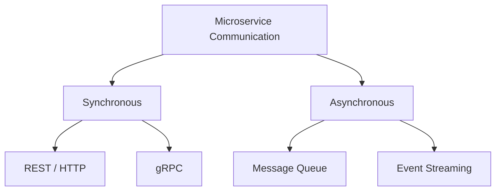
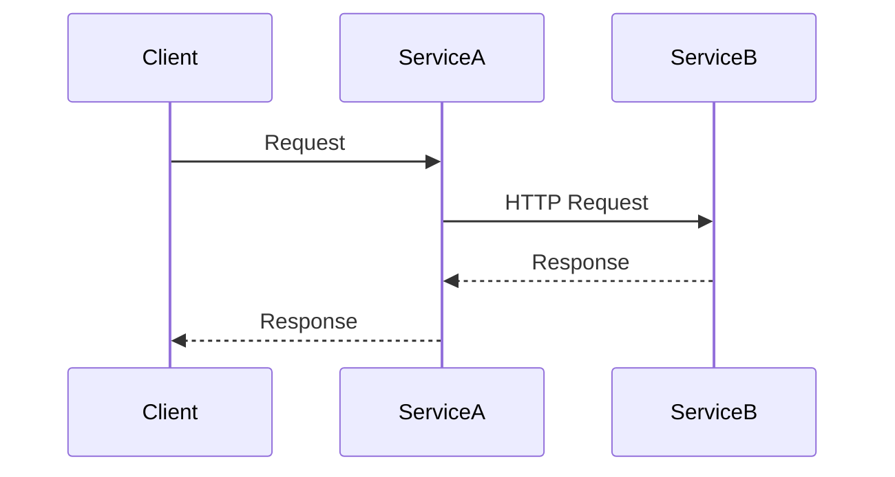
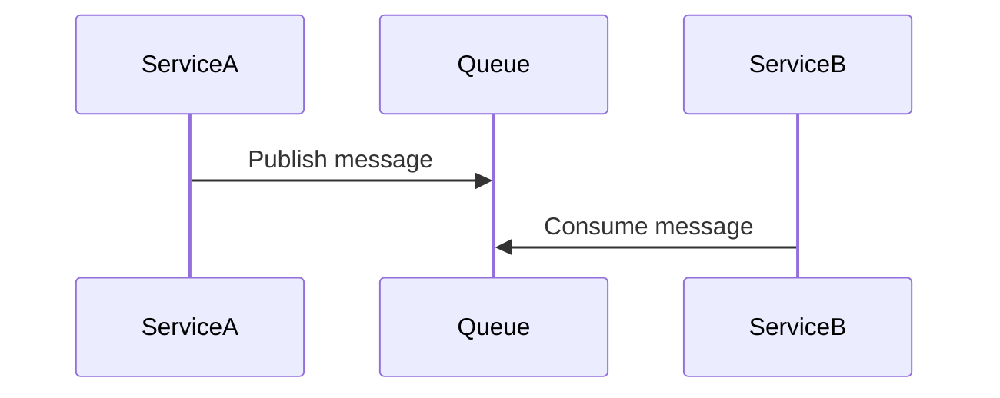
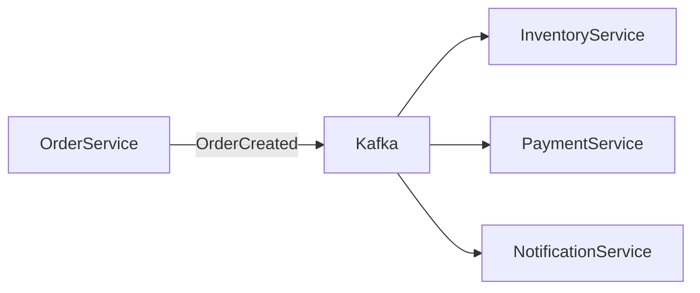

# 🔗 Các kiểu giao tiếp trong Microservices

## 🎯 Mục tiêu bài học

* Giúp học viên **hiểu rõ các kiểu giao tiếp phổ biến trong microservices**
* Nắm được **bối cảnh sử dụng, ưu nhược điểm** của từng kiểu giao tiếp
* Biết cách **lựa chọn mô hình giao tiếp phù hợp khi thiết kế hệ thống phân tán**

---

## 🧠 1. Vì sao giao tiếp là vấn đề sống còn trong Microservices?

Trong monolith, các module gọi nhau qua function → nhanh, đơn giản.

Nhưng trong microservices:

* Gọi nhau **qua network**
* Có **latency, timeout, retry, failure**
* Service có thể **down bất kỳ lúc nào**

👉 Chọn sai kiểu giao tiếp = hệ thống:

* Chậm
* Dễ sập dây chuyền
* Khó scale

---

## 🗂️ 2. Phân loại tổng quan các kiểu giao tiếp

Microservices thường được phân loại theo 2 trục chính:

* **Đồng bộ (Synchronous)** vs **Bất đồng bộ (Asynchronous)**
* **Point-to-point** vs **Event-driven**

---

## 🔄 3. Giao tiếp đồng bộ (Synchronous Communication)

### 🌐 3.1 REST / HTTP (phổ biến nhất)

**Mô tả**:

* Service A gọi API của Service B
* Chờ response rồi mới tiếp tục

**Ưu điểm**:

* Dễ hiểu, dễ debug
* Phù hợp CRUD
* Tooling phong phú (OpenAPI, Postman)

**Nhược điểm**:

* Latency cao khi chain nhiều service
* Dễ gây **cascade failure**
* Scale không tốt nếu gọi chéo nhiều

**Ứng dụng thực tế**:

* Query dữ liệu
* User cần response ngay

---

### ⚡ 3.2 gRPC (High performance synchronous)

**Mô tả**:

* Dựa trên HTTP/2 + Protobuf
* Contract-first

**Ưu điểm**:

* Nhanh, nhẹ
* Type-safe
* Phù hợp internal service-to-service

**Nhược điểm**:

* Khó debug hơn REST
* Không thân thiện browser

**Ứng dụng thực tế**:

* Backend gọi backend
* Hệ thống lớn, cần performance

---

## 📬 4. Giao tiếp bất đồng bộ (Asynchronous Communication)

### 📥 4.1 Message Queue (RabbitMQ, SQS)

**Mô tả**:

* Service A gửi message
* Service B xử lý sau
* Không cần chờ kết quả

**Ưu điểm**:

* Giảm coupling
* Tăng độ ổn định
* Retry dễ

**Nhược điểm**:

* Khó trace flow
* Eventual consistency

**Ứng dụng thực tế**:

* Background job
* Email, notification, async processing

---

### 📡 4.2 Event-driven / Event Streaming (Kafka, Pulsar)

**Mô tả**:

* Service publish event
* Nhiều service subscribe

**Ưu điểm**:

* Scale cực tốt
* Loosely coupled
* Phù hợp domain-driven design

**Nhược điểm**:

* Khó thiết kế
* Debug phức tạp

**Ứng dụng thực tế**:

* Business event
* Hệ thống lớn, nhiều consumer

---

## 📊 5. So sánh nhanh các kiểu giao tiếp

| Kiểu            | Đồng bộ | Coupling | Scale      | Độ phức tạp |
| --------------- | ------- | -------- | ---------- | ----------- |
| REST            | Có      | Cao      | Trung bình | Thấp        |
| gRPC            | Có      | Trung    | Cao        | Trung       |
| Message Queue   | Không   | Thấp     | Cao        | Trung       |
| Event Streaming | Không   | Rất thấp | Rất cao    | Cao         |

---

## ⚠️ 6. Sai lầm phổ biến khi thiết kế giao tiếp Microservices

❌ Dùng REST cho mọi thứ
❌ Chain call quá nhiều service
❌ Không timeout / retry / circuit breaker
❌ Event quá fine-grained

👉 **Rule of thumb**:

* Query → Sync
* Command / Side-effect → Async
* Business event → Event-driven

---

## ✅ 7. Tổng kết bài học

* Không tồn tại một kiểu giao tiếp duy nhất phù hợp cho mọi bài toán microservices
* Việc lựa chọn mô hình giao tiếp ảnh hưởng trực tiếp đến **độ ổn định, khả năng mở rộng và maintainability** của hệ thống
* Trong thực tế, kiến trúc tốt thường là sự **kết hợp có chủ đích giữa synchronous và asynchronous communication**

---

### 📚 Gợi ý học tiếp

* So sánh REST vs gRPC trong nội bộ hệ thống
* Thiết kế Event-driven Architecture với Kafka
* Các pattern quan trọng: Circuit Breaker, Saga, Outbox
