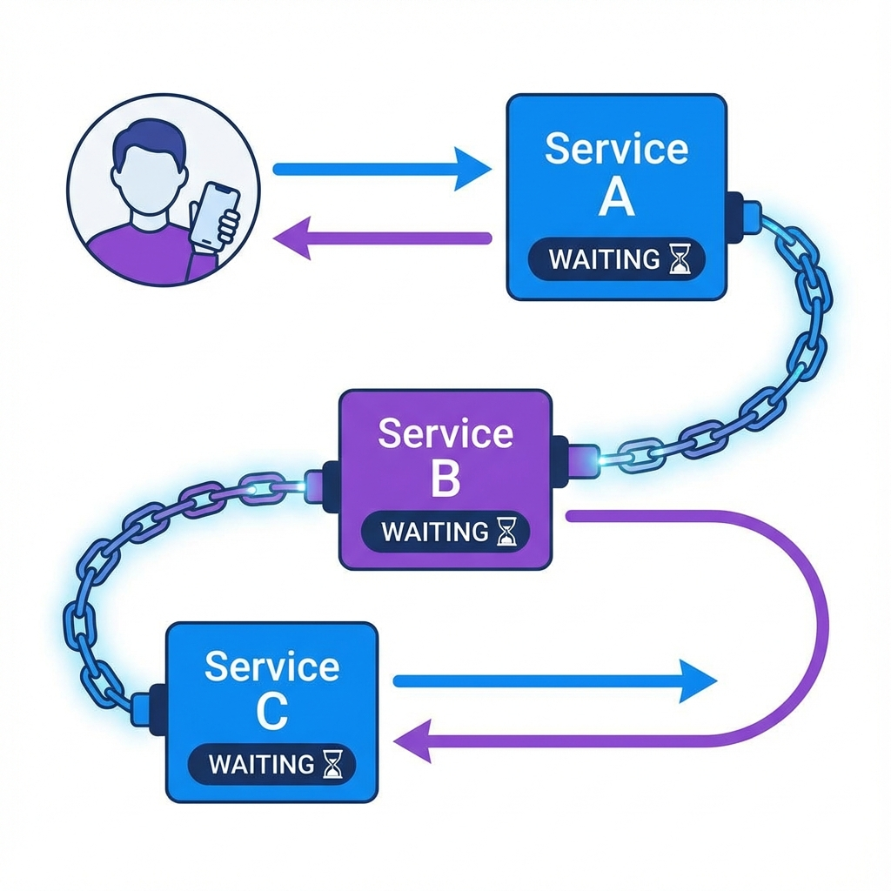
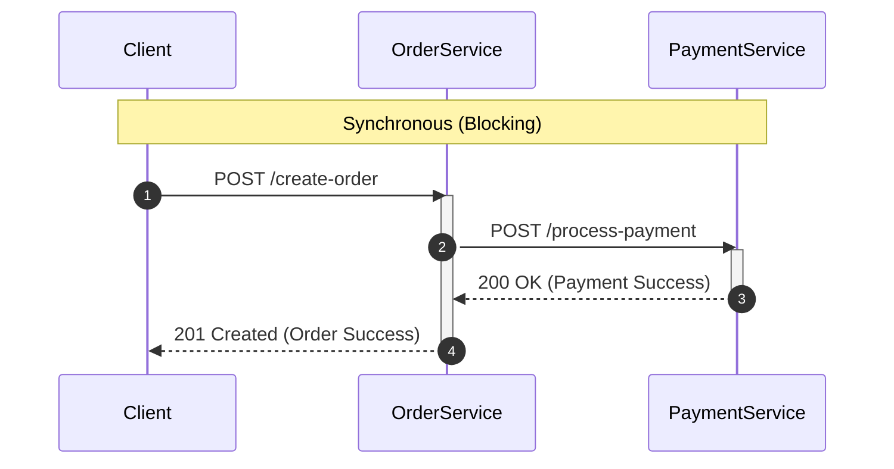
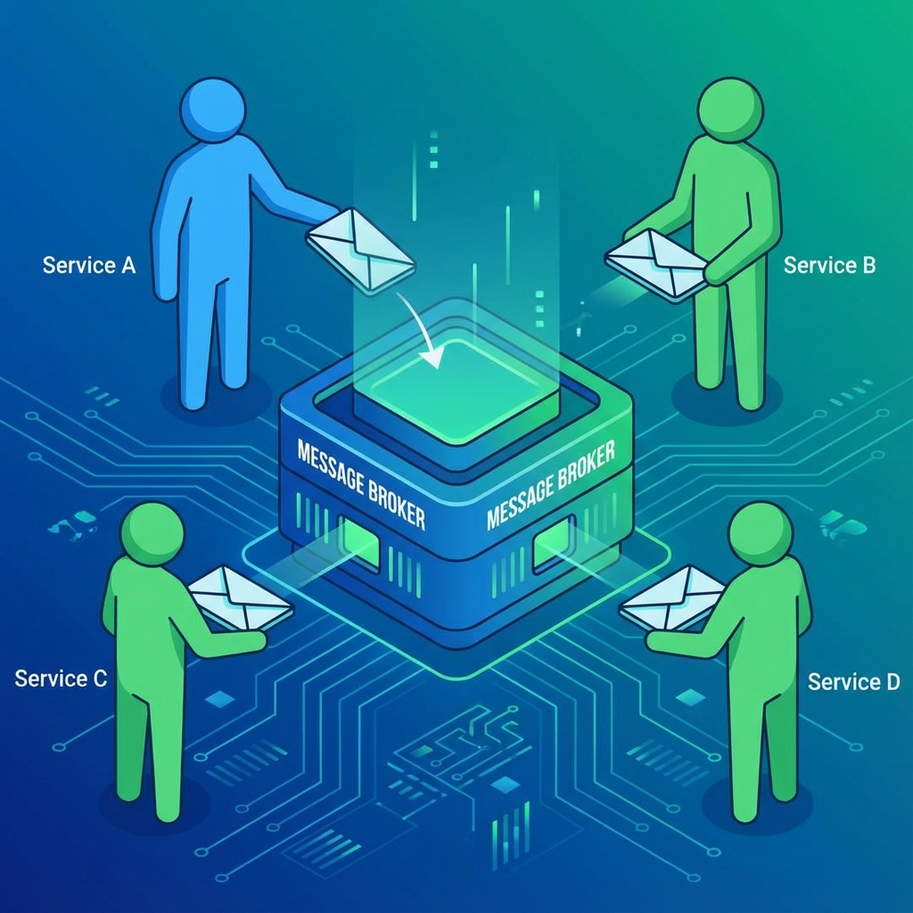
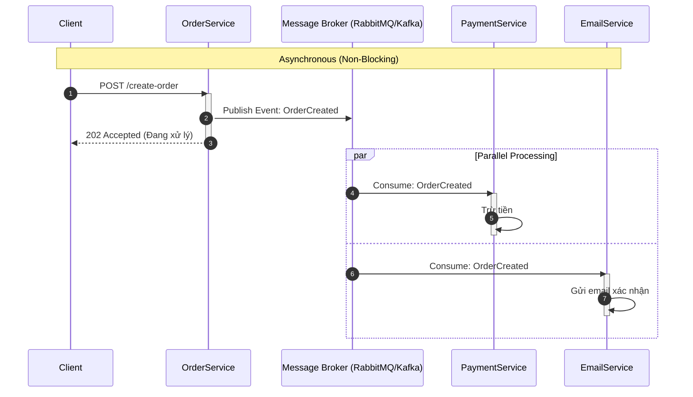
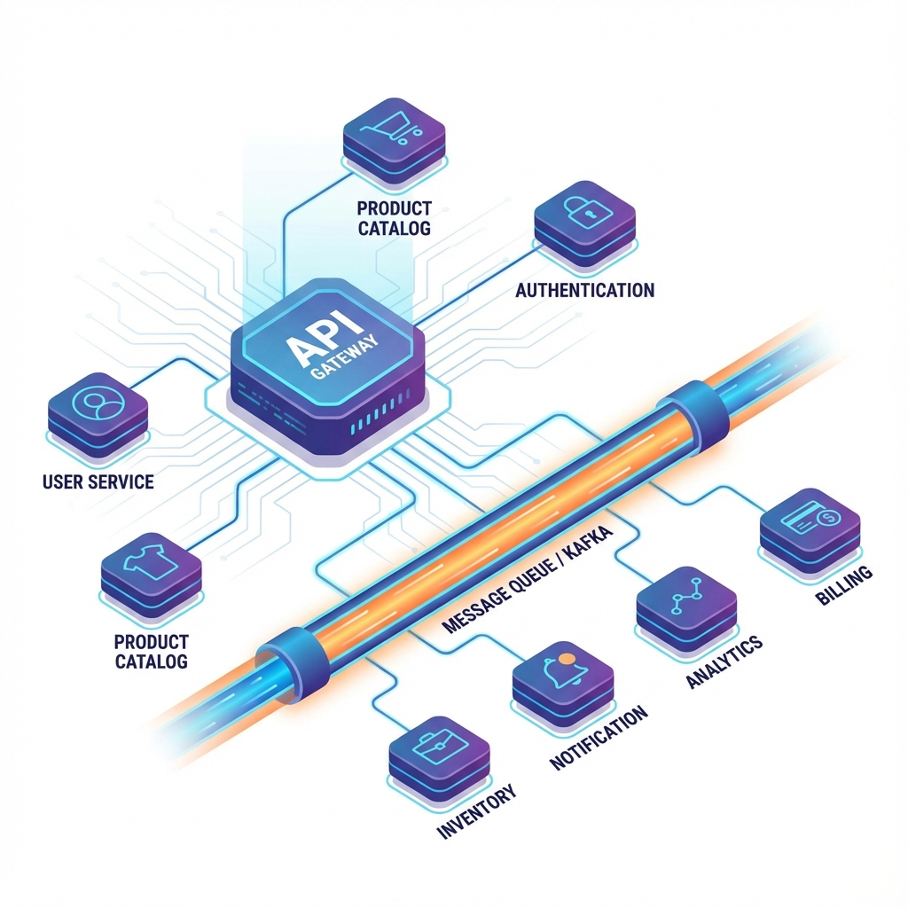

# 32. Các kiểu giao tiếp trong Microservices (Communication Patterns)

Trong kiến trúc Monolithic, các module gọi nhau thông qua **Function Call** (gọi hàm trực tiếp trong RAM), cực kỳ nhanh và đơn giản.
Tuy nhiên, trong Microservices, các service chạy trên các process khác nhau, thậm chí server khác nhau, nên chúng phải giao tiếp qua **Mạng (Network)**.

Việc chọn đúng kiểu giao tiếp là yếu tố sống còn quyết định độ trễ (latency), độ tin cậy (reliability) và khả năng mở rộng (scalability) của hệ thống.

Có hai nhóm giao tiếp chính: **Synchronous (Đồng bộ)** và **Asynchronous (Bất đồng bộ)**.

---

## 1. Synchronous Communication (Giao tiếp đồng bộ)



Cơ chế này tương tự như gọi điện thoại: Bạn gọi, bên kia bắt máy và trả lời ngay lập tức. Nếu bên kia bận, bạn phải chờ.

### Đặc điểm:

- Client gửi request và **block** (chờ) cho đến khi nhận được response từ Server.
- Kết nối trực tiếp điểm-điểm (Point-to-Point).

### Các công nghệ phổ biến:

1.  **REST (HTTP/JSON):** Phổ biến nhất, dễ dùng, human-readable.
2.  **gRPC (HTTP/2 + Protobuf):** Hiệu năng cao, contract chặt chẽ, thích hợp gọi nội bộ giữa các service.
3.  **GraphQL:** Linh hoạt cho client lấy dữ liệu, thường dùng ở tầng Gateway -> Client.

### Ưu điểm & Nhược điểm:

- ✅ **Ưu điểm:** Đơn giản, dễ debug, phản hồi realtime ngay lập tức.
- 🚫 **Nhược điểm:**
  - **Coupling (Phụ thuộc):** Service A gọi Service B. Nếu B chết -> A lỗi hoặc treo (Cascading Failure).
  - **Latency:** Tổng thời gian = tổng thời gian xử lý của chuỗi các service (A -> B -> C).

### Mô hình hóa:



---

## 2. Asynchronous Communication (Giao tiếp bất đồng bộ)



Cơ chế này tương tự như gửi Email: Bạn gửi thư đi và quay lại làm việc khác. Bạn không cần bên kia trả lời ngay lập tức. Bên kia sẽ đọc và xử lý thư khi họ rảnh.

### Đặc điểm:

- Client gửi message và **không chờ** (non-blocking) response ngay lập tức.
- Thường thông qua một trung gian gọi là **Message Broker**.

### Các công nghệ phổ biến:

1.  **Message Queues (RabbitMQ, ActiveMQ):** Thích hợp cho xử lý background task (gửi mail, xử lý ảnh).
2.  **Event Streaming (Apache Kafka):** Thích hợp cho xử lý dữ liệu lớn, log aggregation, event sourcing.

### Các Pattern phổ biến:

- **One-to-One (Queue):** 1 message chỉ được xử lý bởi 1 consumer.
- **Pub/Sub (Publish/Subscribe):** 1 message được bắn ra (Event), nhiều service khác nhau cùng nhận và xử lý theo cách riêng.

### Ưu điểm & Nhược điểm:

- ✅ **Ưu điểm:**
  - **Decoupling (Gỡ rối):** Service A gửi xong là xong, không quan tâm Service B có sống hay chết.
  - **Traffic Spike:** Message Broker đóng vai trò "Buffer" giúp hệ thống không bị sập khi lượng request tăng đột biến.
- 🚫 **Nhược điểm:**
  - **Phức tạp:** Khó debug, khó trace luồng đi của message.
  - **Eventual Consistency:** Dữ liệu không đồng bộ ngay lập tức.

### Mô hình hóa:



---

## 3. So sánh và Lựa chọn

| Tiêu chí                  | Synchronous (REST/gRPC)          | Asynchronous (Message Queue)       |
| :------------------------ | :------------------------------- | :--------------------------------- |
| **Kiểu giao tiếp**        | Request / Response               | Fire and Forget / Pub-Sub          |
| **Độ trễ (Latency)**      | Thấp (nếu mạng tốt)              | Cao hơn (do qua Broker)            |
| **Độ ăn khớp (Coupling)** | Cao (Chặt chẽ)                   | Thấp (Lỏng lẻo)                    |
| **Xử lý lỗi**             | Client phải retry hoặc fail ngay | Broker giữ message, retry sau      |
| **Sử dụng khi**           | Cần kết quả ngay (Login, Search) | Tác vụ chạy nền (Gửi mail, Report) |

---

## 4. Hybrid: Sự kết hợp hoàn hảo



Trong thực tế, một hệ thống Microservices chuẩn thường kết hợp cả hai:

1.  **Frontend -> Gateway -> Service:** Dùng **REST/GraphQL** (Sync) để lấy dữ liệu hiển thị cho User.
2.  **Service -> Service (Internal - Read):** Dùng **gRPC** (Sync) khi Service A cần data từ Service B để trả về ngay cho User.
3.  **Service -> Service (Internal - Write/Action):** Dùng **Message Queue** (Async) khi Service A muốn báo cho Service B thực hiện một hành động (Tạo đơn hàng -> Trừ kho, Gửi mail, Tích điểm).

### Ví dụ Hybrid Architecture:

```mermaid
graph TD
    Client((User))
    GW[API Gateway]
    SvcOrder[Order Service]
    SvcInv[Inventory Service]
    SvcEmail[Email Service]
    Broker[[Kafka / RabbitMQ]]

    %% Sync Flows
    Client -->|REST HTTP| GW
    GW -->|REST HTTP| SvcOrder
    SvcOrder -->|gRPC (Check Stock)| SvcInv

    %% Async Flows
    SvcOrder -.->|Publish Event: OrderPlaced| Broker
    Broker -.->|Consume| SvcEmail
    Broker -.->|Consume| SvcInv

    style Client fill:#fff,stroke:#333
    style GW fill:#f96,stroke:#333
    style Broker fill:#69f,stroke:#333
```
