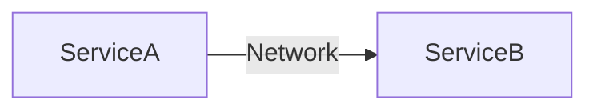
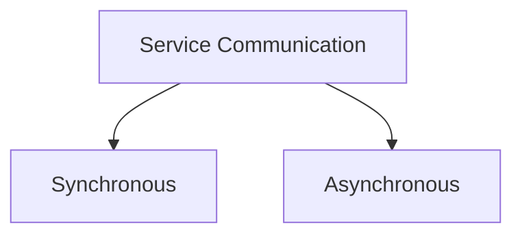
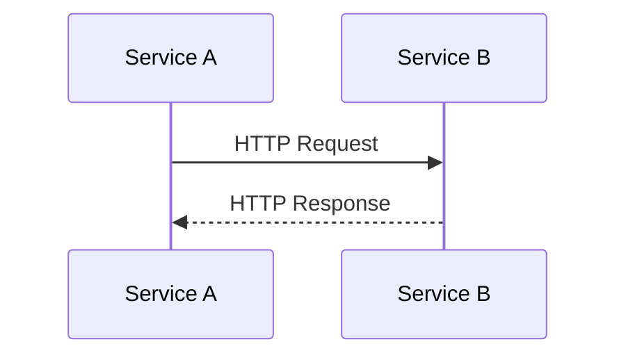
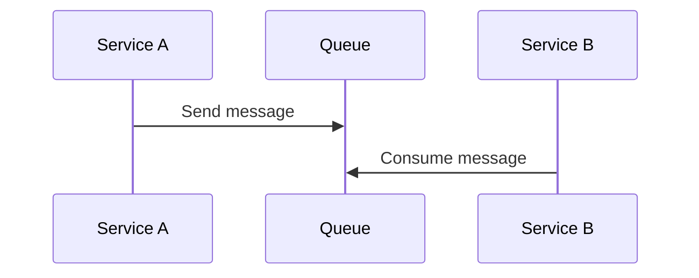
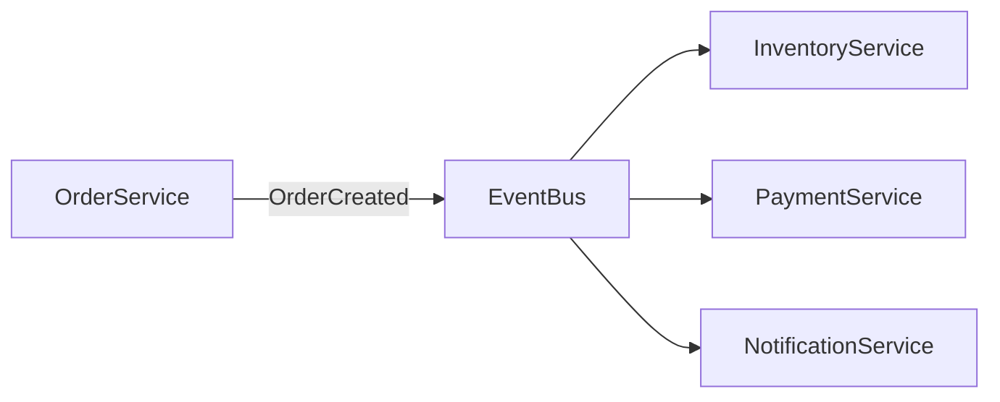

# 🔄 Giao tiếp trong Microservices như thế nào?

## 🎯 Mục tiêu bài học

* Hiểu **bản chất giao tiếp giữa các service** trong kiến trúc microservices
* Trả lời được câu hỏi: **Service nên giao tiếp với nhau như thế nào cho đúng?**
* Biết cách **thiết kế luồng giao tiếp an toàn, hiệu quả và dễ mở rộng**

---

## 🧠 1. Microservices giao tiếp với nhau ra sao?

Trong microservices, mỗi service:

* Chạy **độc lập**
* Có **database riêng**
* Deploy, scale **không đồng bộ** với service khác

👉 Vì vậy, service **không thể gọi trực tiếp function** như trong monolith.

Thay vào đó, microservices **chỉ giao tiếp thông qua network**, phổ biến là:

* HTTP / gRPC
* Message broker
* Event streaming platform

---

## 🧩 2. Những vấn đề phát sinh khi giao tiếp qua network

Khi giao tiếp qua network, hệ thống sẽ đối mặt với:

* ⏱️ **Latency** (chậm hơn gọi hàm nội bộ)
* ❌ **Partial failure** (service A sống, service B chết)
* 🔁 **Retry & duplicate message**
* 🌐 **Network không ổn định**

👉 Vì vậy, thiết kế giao tiếp **quan trọng hơn code business logic**.

---

## 🗂️ 3. Các cách giao tiếp phổ biến trong Microservices

Microservices thường giao tiếp theo 2 hướng chính:

* 🔄 **Đồng bộ (Synchronous)** – gọi và chờ phản hồi
* 📬 **Bất đồng bộ (Asynchronous)** – gửi rồi tiếp tục xử lý

---

## 🔄 4. Giao tiếp đồng bộ diễn ra như thế nào?

### 🌐 REST / HTTP

**Cách hoạt động**:

* Service A gửi request
* Service B xử lý và trả response
* Service A **bị block** cho đến khi nhận kết quả

**Ví dụ thực tế**:

👉 *User mở trang chi tiết sản phẩm trong website thương mại điện tử*

* Frontend gọi **Product Service** để lấy thông tin sản phẩm
* Product Service trả về tên, giá, mô tả
* Người dùng **cần dữ liệu ngay lập tức** để xem

➡️ Trường hợp này **bắt buộc dùng giao tiếp đồng bộ**.

**Khi nào nên dùng**:

* Lấy dữ liệu (query)
* Người dùng cần phản hồi ngay

**Rủi ro cần kiểm soát**:

* Timeout
* Retry
* Circuit Breaker

---

## ⚡ 5. Giao tiếp backend với backend hiệu năng cao (gRPC)

**Cách hoạt động**:

* Giao tiếp qua HTTP/2
* Dùng Protobuf thay vì JSON

**Phù hợp khi**:

* Service-to-service internal
* Hệ thống lớn, traffic cao

👉 gRPC **không thay thế REST**, mà bổ sung cho các luồng nội bộ.

---

## 📬 6. Giao tiếp bất đồng bộ diễn ra như thế nào?

### 📥 Message Queue

**Cách hoạt động**:

* Service A gửi message vào queue
* Service B xử lý sau, độc lập với A

**Ví dụ thực tế**:

👉 *Người dùng đặt hàng thành công*

* Order Service lưu đơn hàng
* Gửi message `OrderCreated` vào queue
* Email Service xử lý gửi email xác nhận

➡️ Order **không cần chờ email gửi xong** để trả kết quả cho user.

**Lợi ích**:

* Không block
* Chịu lỗi tốt
* Dễ scale

---

## 📡 7. Giao tiếp theo sự kiện (Event-driven)

**Cách hoạt động**:

* Service phát sinh **event**
* Các service khác **lắng nghe và phản ứng**

**Ví dụ thực tế**:

👉 *Một đơn hàng được tạo thành công*

* Order Service phát event `OrderCreated`
* Inventory Service trừ tồn kho
* Payment Service khởi tạo thanh toán
* Notification Service gửi thông báo

➡️ Order Service **không cần biết** có bao nhiêu service xử lý phía sau.

👉 Service **không biết ai đang nghe mình** → coupling rất thấp.

---

## 🧠 8. Nên chọn cách giao tiếp nào?

👉 Không hỏi: *"Dùng công nghệ gì?"*
👉 Hỏi đúng: *"Luồng nghiệp vụ này cần giao tiếp như thế nào?"*

**Rule of thumb**:

* Query dữ liệu → 🔄 Sync
* Xử lý nền / side-effect → 📬 Async
* Thông báo thay đổi nghiệp vụ → 📡 Event

---

## ⚠️ 9. Sai lầm phổ biến

❌ Giao tiếp đồng bộ cho mọi luồng
❌ REST chain quá nhiều service
❌ Thiếu timeout, retry, circuit breaker
❌ Lạm dụng event cho logic đơn giản

---

## ✅ 10. Tổng kết bài học

* Microservices **luôn giao tiếp qua network**
* Network = không ổn định → phải thiết kế cẩn thận
* Kiến trúc tốt là kiến trúc **chọn đúng cách giao tiếp cho đúng bài toán**

---

