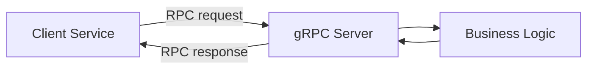
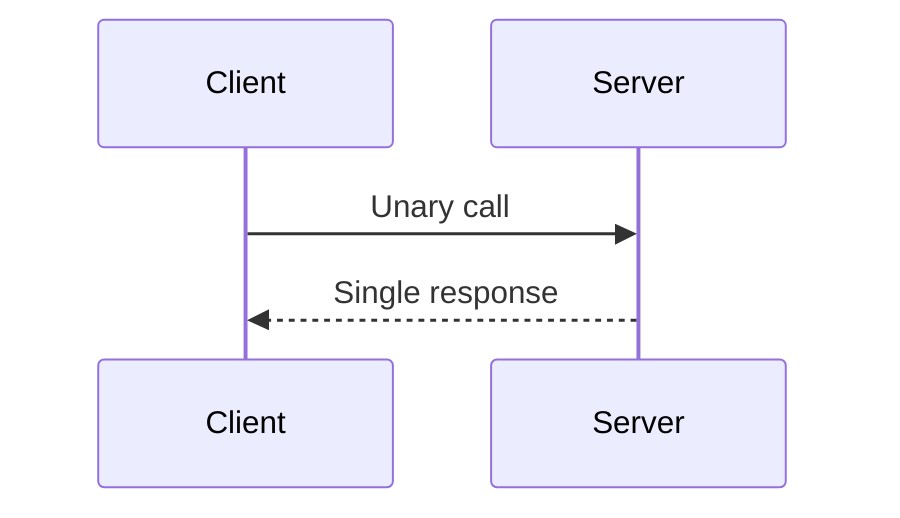
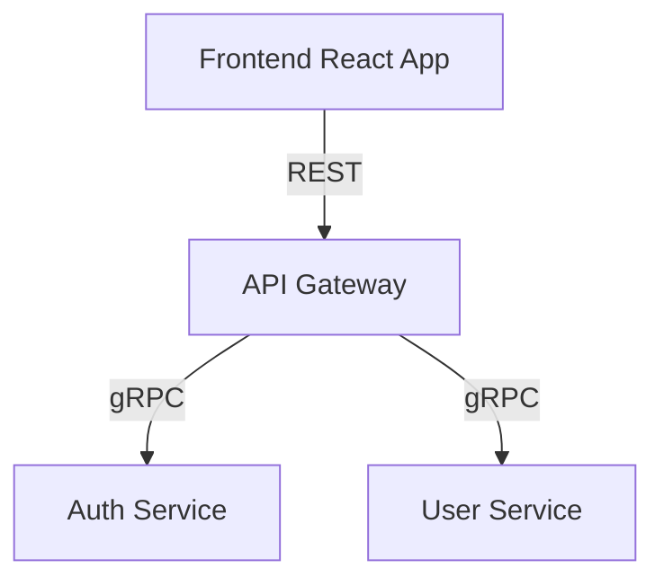

# 🧩 Giới thiệu và Tìm hiểu về gRPC

## 🎯 Mục tiêu học tập
- Hiểu khái niệm gRPC là gì và vì sao nó ra đời.  
- Nắm được kiến trúc hoạt động của gRPC.  
- Biết cách định nghĩa `proto file` và các kiểu truyền dữ liệu (Unary, Streaming).  
- So sánh gRPC với REST và các mô hình giao tiếp khác trong microservice.

---

## 🔍 1. gRPC là gì?

**gRPC** (Google Remote Procedure Call) là framework RPC hiệu năng cao mã nguồn mở được Google phát triển, giúp các **service giao tiếp với nhau** như gọi hàm nội bộ — thay vì gọi qua HTTP thông thường.

> 💡 Nó sử dụng **Protocol Buffers (protobuf)** để serialize dữ liệu → nhanh và tiết kiệm băng thông hơn JSON.

---

## 🧱 2. Kiến trúc gRPC



**Giải thích:**
- Client gửi request đến Server bằng việc gọi hàm được định nghĩa trong `.proto`.
- Server thực thi hàm tương ứng rồi trả kết quả lại cho Client.

---

## 🧩 3. Protocol Buffers (protobuf)

Là format dữ liệu binary giúp serialize nhanh hơn JSON.

Ví dụ file `user.proto`:

```proto
syntax = "proto3";

package user;

message User {
  string id = 1;
  string name = 2;
  string email = 3;
}

service UserService {
  rpc GetUserById (GetUserRequest) returns (User);
}

message GetUserRequest {
  string id = 1;
}
```

### 👉 Quá trình build
```bash
protoc --js_out=import_style=commonjs,binary:. user.proto
```

> Output: sinh ra file client/server code để dễ dàng gọi các hàm RPC.

---

## 🔄 4. Các kiểu giao tiếp trong gRPC

| Kiểu RPC | Mô tả | Sơ đồ |
|-----------|--------|-------|
| Unary | Client gửi 1 request, nhận 1 response | `A → B → A` |
| Server Streaming | Client gửi 1 request, nhận nhiều response | `A → B ⇢⇢⇢ A` |
| Client Streaming | Client gửi nhiều request, nhận 1 response | `A ⇢⇢⇢ B → A` |
| Bidirectional Streaming | Hai chiều liên tục | `A ⇢⇢⇢ B ⇢⇢⇢ A` |



---

## ⚖️ 5. So sánh gRPC và REST API

| Tiêu chí | REST | gRPC |
|-----------|------|------|
| Data format | JSON | Protocol Buffers (binary) |
| Hiệu năng | Trung bình | Cao |
| Hỗ trợ Streaming | Giới hạn | Có |
| Type Safety | Không có | Có (qua `.proto`) |
| Giao tiếp đa ngôn ngữ | Dễ dùng cho Web | Dễ dùng cho backend service |
| Tool test | Postman | BloomRPC / Kreya |

---

## 🧭 6. Khi nào nên dùng gRPC

✅ **Nên dùng khi:**
- Các service giao tiếp nội bộ trong hệ thống microservice.  
- Cần hiệu năng cao, low-latency.  
- Backend to Backend (B2B) communication.

🚫 **Không nên dùng khi:**
- Xây API public cho client browser (vì browser không hỗ trợ native gRPC).  
- Cần test nhanh mà không cần generate code.

---

## 🧩 7. Demo trực quan



> Đây là mô hình phổ biến: **REST cho frontend**, **gRPC cho backend inter-service communication**.

---

## 🧠 Tổng kết

- gRPC là nền tảng RPC hiệu năng cao, type-safe, rất phù hợp cho microservice.  
- Protocol Buffers giúp encode/decode nhanh hơn JSON nhiều lần.  
- Bài tiếp theo, chúng ta sẽ **xây dựng microservice NestJS** sử dụng gRPC để thấy toàn bộ flow thực tế.
