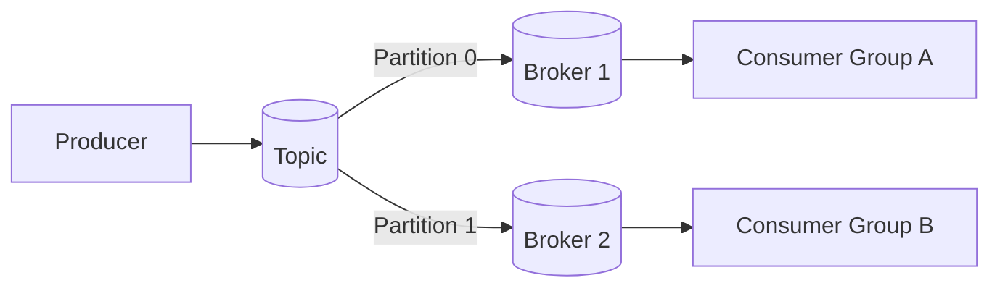
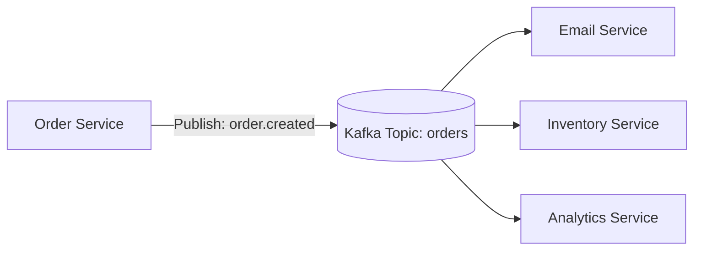
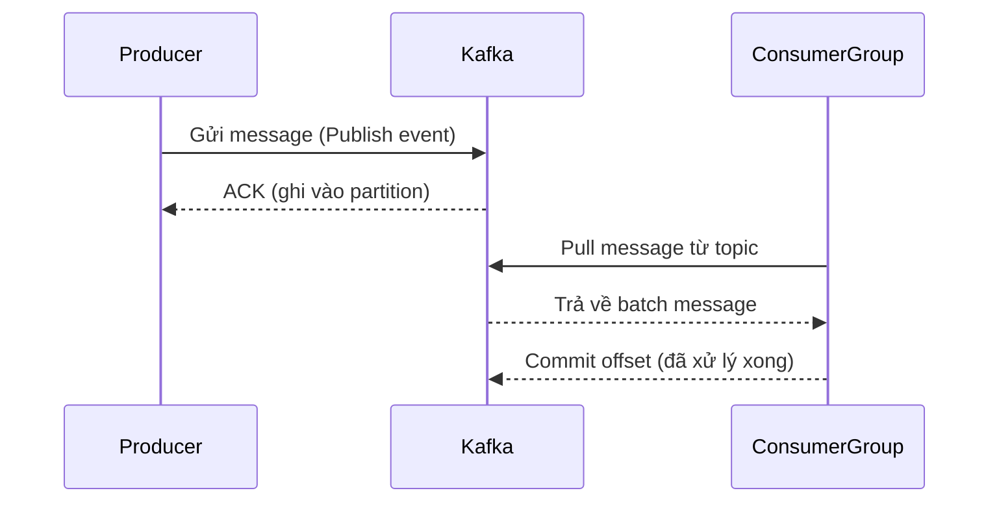

# 🧭 Bài học: Apache Kafka – Message Streaming cho Hệ thống Microservices

## 1. Giới thiệu tổng quan về Apache Kafka

**Apache Kafka** là một nền tảng **event streaming phân tán (distributed event streaming platform)**, được thiết kế để **xử lý dữ liệu real-time, với throughput cao và độ tin cậy cực tốt**.

Kafka ban đầu được phát triển bởi LinkedIn và hiện nay là một trong những công nghệ cốt lõi trong hệ sinh thái microservices.

### 1.1 Kafka dùng để làm gì?

- **Message Queue** hiện đại — giúp các service giao tiếp bất đồng bộ.  
- **Event Streaming Platform** — xử lý dữ liệu real-time, như log, analytics, metrics.  
- **Data Integration Hub** — trung gian để đồng bộ dữ liệu giữa các hệ thống khác nhau.

### 1.2 Kiến trúc cơ bản của Kafka



Các thành phần chính:

| Thành phần | Vai trò |
|-------------|----------|
| **Producer** | Gửi (publish) message vào topic |
| **Consumer** | Nhận (subscribe) message từ topic |
| **Topic** | Kênh lưu trữ message (giống như “queue” logic) |
| **Partition** | Chia nhỏ topic để tăng khả năng song song |
| **Broker** | Node server Kafka lưu trữ dữ liệu |
| **Zookeeper / KRaft** | Quản lý metadata (Kafka 3.x+ dùng KRaft thay Zookeeper) |

### 1.3 Kafka khác gì với RabbitMQ?

| So sánh | Kafka | RabbitMQ |
|----------|------------|---------------|
| Mục đích chính | Event streaming | Message queue truyền thống |
| Tốc độ xử lý | Cực nhanh | Nhanh nhưng không bằng Kafka |
| Lưu trữ message | Lưu lâu dài (retention policy) | Xóa sau khi consumer đọc |
| Cách xử lý | Pull-based | Push-based |
| Use case phổ biến | Data pipeline, microservices, analytics | Job queue, transactional tasks |

## 2. Cách Kafka hoạt động trong hệ thống Microservice

Giả sử bạn có hệ thống e-commerce, gồm các service:

- `OrderService` → tạo đơn hàng  
- `EmailService` → gửi email xác nhận  
- `InventoryService` → cập nhật kho  
- `AnalyticsService` → lưu log hành vi người dùng

### Khi có đơn hàng mới

1. `OrderService` publish event `order.created` vào topic `orders`.  
2. Các service khác subscribe topic `orders` và xử lý tùy mục đích.



### Flow tổng thể giữa Producer, Topic và Consumer



## 3. Demo thực tế: Kafka trong dự án Node.js / NestJS

### 3.1 Cài đặt bằng Docker

```yaml
# docker-compose.yml
version: '3'
services:
  zookeeper:
    image: wurstmeister/zookeeper
    ports:
      - "2181:2181"
  kafka:
    image: wurstmeister/kafka
    ports:
      - "9092:9092"
    environment:
      KAFKA_ZOOKEEPER_CONNECT: zookeeper:2181
      KAFKA_ADVERTISED_LISTENERS: PLAINTEXT://localhost:9092
```

### 3.2 Producer ví dụ

```ts
import { Kafka } from 'kafkajs';

const kafka = new Kafka({ brokers: ['localhost:9092'] });
const producer = kafka.producer();

await producer.connect();
await producer.send({
  topic: 'orders',
  messages: [{ key: 'orderId', value: JSON.stringify({ id: 1, total: 100 }) }],
});
await producer.disconnect();
```

### 3.3 Consumer ví dụ

```ts
const consumer = kafka.consumer({ groupId: 'email-service' });
await consumer.connect();
await consumer.subscribe({ topic: 'orders' });

await consumer.run({
  eachMessage: async ({ topic, partition, message }) => {
    const order = JSON.parse(message.value.toString());
    console.log(`📧 Send email for order #${order.id}`);
  },
});
```

## 4. Kinh nghiệm triển khai Kafka trong Production

### 4.1 Best Practices
- **Idempotent Producer & Consumer:** tránh xử lý trùng khi retry.  
- **Consumer Group** giúp scale horizontal mà vẫn tránh xử lý trùng.  
- **DLQ (Dead Letter Queue):** lưu message lỗi không xử lý được.  
- **Monitoring Lag:** theo dõi độ trễ để phát hiện quá tải.  
- **Compression (snappy/gzip):** giảm dung lượng truyền tải.

### 4.2 Bảo mật & quản lý
- Dùng **SASL / SSL** để bảo mật kết nối giữa producer và broker.  
- Hạn chế quyền truy cập bằng **ACL** (Access Control List).  
- Theo dõi qua **Kafka UI / Conduktor / Kafdrop** để debug và quan sát message.

### 4.3 Kinh nghiệm thực tế
- Kafka cực kỳ mạnh nhưng cũng dễ “overkill” nếu chỉ cần xử lý event nhỏ.  
- Với hệ thống quy mô lớn, Kafka là “xương sống” cho các event bất đồng bộ.  
- Trong microservices, coi Kafka như **event bus trung tâm** — nơi mọi sự kiện đều được publish và xử lý tách biệt.

## ✅ Kết luận
- Apache Kafka là **hệ thống message streaming phân tán**, phù hợp cho microservices và real-time analytics.  
- Giúp giảm coupling, tăng throughput, đảm bảo dữ liệu bền vững.  
- Dù setup hơi phức tạp, nắm được nguyên lý — Kafka sẽ trở thành “trái tim” cho kiến trúc microservice của bạn.

> 💬 “Kafka không chỉ là một message queue, mà là **nền tảng xử lý dữ liệu real-time** cho toàn bộ hệ thống.”
