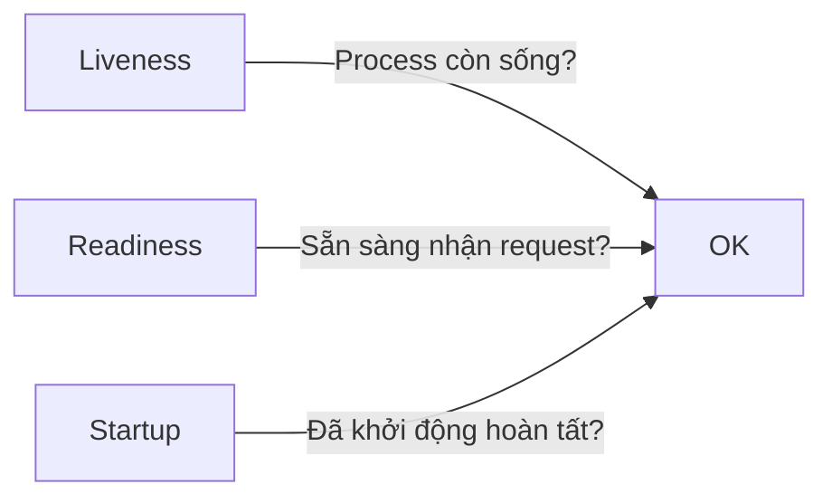

# 🚦 Health Check trong Microservices

## 1. Health Check là gì?

👉 Một **cơ chế “đo mạch”** giúp biết service có đang khỏe hay không.

Dễ hiểu như kiểm tra:

* Service có **sống** không? (Liveness)
* Service có **đủ tỉnh táo** để nhận request không? (Readiness)
* Service có **khởi động xong chưa**? (Startup)

---

## 2. Vì sao cần Health Check?

### 🎯 Mục tiêu chính

```
[User] → [Load Balancer] → [Service A]
                               ↑
                         Health Check nói xem có OK không
```

### 🧩 Lợi ích

| Lý do                                | Giải thích ngắn gọn                              |
| ------------------------------------ | ------------------------------------------------ |
| 🛑 Phát hiện lỗi sớm                 | Service chậm, treo, hoặc mất DB → phát hiện ngay |
| 🔄 Tự phục hồi                       | K8s tự restart container lỗi                     |
| 🚫 Tránh gửi traffic vào service lỗi | Readiness bảo vệ hệ thống khỏi lỗi dây chuyền    |
| 📈 Scale ổn định                     | Instance mới chỉ nhận traffic khi đã sẵn sàng    |
| 📡 Tích hợp monitoring               | Prometheus/Grafana dựa vào health check để alert |

---

## 3. Các loại Health Check (Cực dễ hiểu)



### **3.1 Liveness Check**

* Kiểm tra: "Process có chết không?"
* Nếu fail → restart ngay.

### **3.2 Readiness Check**

* Kiểm tra: "Đủ điều kiện nhận traffic chưa?"
* Nếu fail → load balancer *không gửi request*.

### **3.3 Startup Check**

* Dùng cho app startup lâu (NestJS + heavy modules, Java Spring Boot...).

---

## 4. Những gì thường được kiểm tra

```
🔌 Database
⚡ Cache (Redis)
📬 Message Queue (Kafka, RabbitMQ)
💾 Disk
🧠 CPU – RAM
🌐 External APIs
```

---

## 5. Ví dụ kết quả Health Check (trực quan hơn)

```json
{
  "status": "ok",
  "components": {
    "db": "connected",
    "redis": "connected",
    "cpu_usage": "normal",
    "uptime": "4h 12m"
  }
}
```

---

## 6. Health Check trong Kubernetes (tóm gọn – dễ hiểu)

### Liveness Probe

```yaml
livenessProbe:
  httpGet:
    path: /health/live
    port: 3000
  periodSeconds: 5
```

### Readiness Probe

```yaml
readinessProbe:
  httpGet:
    path: /health/ready
    port: 3000
  periodSeconds: 5
```

---

## 7. Best Practices (ngắn – nhanh – đúng)

* Tách endpoint: **/health/live**, **/health/ready**.
* Response phải nhanh (<200ms).
* Không làm logic nặng trong health check.
* Có timeout cho các dependency.
* Ghi log khi health check fail.

---

## 8. Kết luận

Health check giúp hệ thống **ổn định, tự phục hồi, tránh sập dây chuyền**, và luôn sẵn sàng scale. Đây là một trong những nền tảng quan trọng nhất của kiến trúc microservices.
