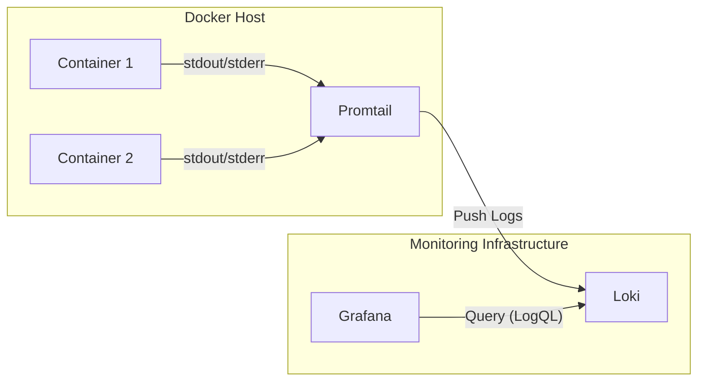

# 28 Centralize Logging với Grafana + Promtail + Loki

Trong bài này, chúng ta sẽ đi vào triển khai thực tế **PLG Stack** (Promtail, Loki, Grafana) để thu thập Logs từ Docker containers.

## 1. Kiến trúc luồng dữ liệu



1.  **Promtail** sẽ bind vào `docker.sock` hoặc đọc file log của Docker (`/var/lib/docker/containers/...`).
2.  Nó tự động phát hiện (service discovery) các container đang chạy.
3.  Log được gửi tới **Loki**.
4.  Người dùng vào **Grafana** để query dữ liệu từ Loki.

## 2. Cấu hình Docker Compose

Chúng ta sẽ thêm 3 service chính vào file `docker-compose.provider.yaml` của project.

```yaml
loki:
  image: grafana/loki:2.9.2
  container_name: loki
  ports:
    - '3100:3100'
  command: -config.file=/etc/loki/local-config.yaml
  networks:
    - einvoice-nw

promtail:
  image: grafana/promtail:2.9.2
  container_name: promtail
  volumes:
    - /var/run/docker.sock:/var/run/docker.sock
    - ./docker/promtail-config.yaml:/etc/promtail/config.yaml
  command: -config.file=/etc/promtail/config.yaml
  networks:
    - einvoice-nw
  depends_on:
    - loki

grafana:
  image: grafana/grafana:10.2.0
  container_name: grafana
  ports:
    - '3000:3000'
  environment:
    - GF_SECURITY_ADMIN_USER=admin
    - GF_SECURITY_ADMIN_PASSWORD=admin
    - GF_USERS_ALLOW_SIGN_UP=false
  networks:
    - einvoice-nw
  depends_on:
    - loki
```

> **Lưu ý:** `promtail` cần quyền truy cập vào `/var/run/docker.sock` của máy host để có thể tự động lấy log từ các container khác.

## 3. Cấu hình Promtail (`docker/promtail-config.yaml`)

Đây là nơi cấu hình "ma thuật" xảy ra. Promtail cần biết làm sao để lấy log từ Docker.

```yaml
server:
  http_listen_port: 9080
  grpc_listen_port: 0

positions:
  filename: /tmp/positions.yaml

clients:
  - url: http://loki:3100/loki/api/v1/push

scrape_configs:
  - job_name: docker
    docker_sd_configs:
      - host: unix:///var/run/docker.sock
        refresh_interval: 5s
    relabel_configs:
      - source_labels: ['__meta_docker_container_name']
        regex: '/(.*)'
        target_label: 'container'
```

**Giải thích:**

- `clients`: Địa chỉ của Loki server (`http://loki:3100...`).
- `docker_sd_configs`: Sử dụng Service Discovery của Docker để tự động tìm container.
- `relabel_configs`: Đây là bước quan trọng để làm sạch label. Mặc định Docker label sẽ khá dài dòng, đoạn này giúp chúng ta lấy tên container (ví dụ `einvoice-app`) và gán vào label `container`.

## 4. Kiểm tra trên Grafana

Sau khi chạy `docker-compose up -d`, hãy làm theo các bước sau:

1.  Truy cập Grafana: [http://localhost:3000](http://localhost:3000) (User/Pass: `admin/admin`).
2.  **Add Data Source:**
    - Chọn **Loki**.
    - URL: `http://loki:3100`.
    - Nhấn **Save & Test**.
3.  **Explore Logs:**
    - Vào menu **Explore** (hình la bàn).
    - Chọn source là **Loki**.
    - Tại phần Label filters, chọn `container` -> chọn tên container bạn muốn xem (ví dụ `postgres_server` hoặc `bbf_service`).
    - Nhấn **Run query** (nút màu xanh).

### Query ví dụ (LogQL)

- Xem tất cả log của `bbf-service`:

  ```bash
  {container="bbf-service"}
  ```

- Tìm kiếm text "error" trong logs:
  ```bash
  {container="bbf-service"} |= "error"
  ```

### Kết luận

Với setup này, bạn không cần phải cấu hình gì trong code của Microservice (NodeJS, Java, Go...). Chỉ cần in log ra console (`console.log`), Promtail sẽ tự động thu gom và đánh index. Đây là cách tiếp cận **Non-intrusive** (không xâm lấn) rất hiệu quả.
