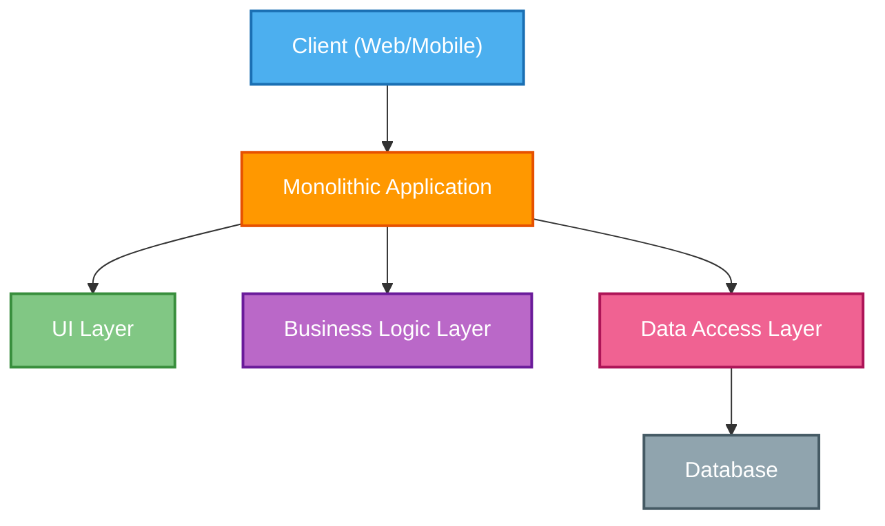
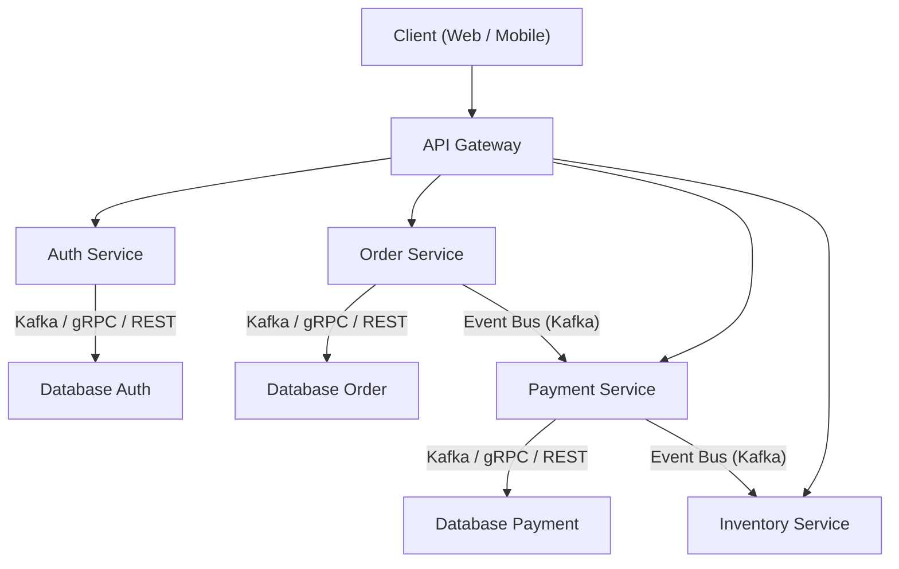
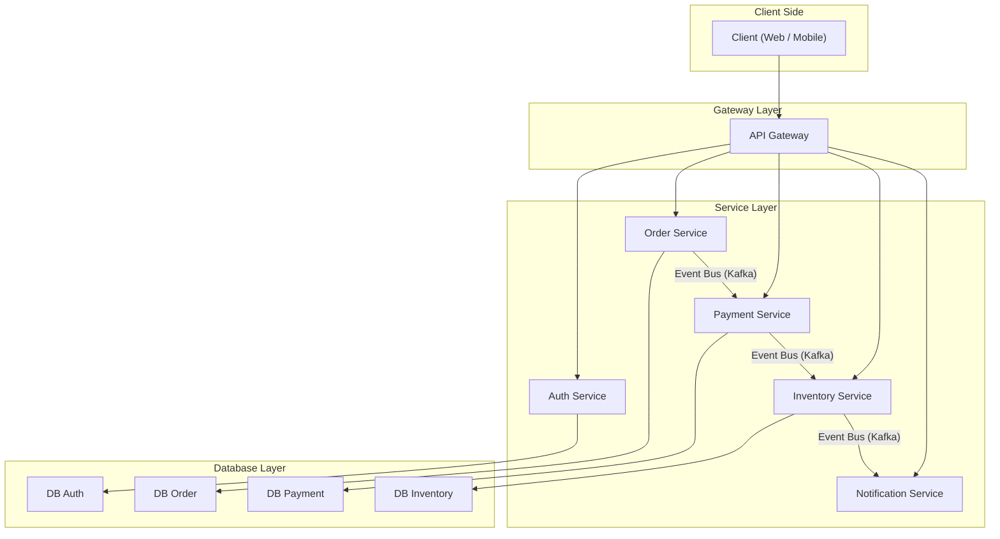

# 📚 Lesson 1: Giới thiệu về Microservice Architecture

## 🎯 Mục tiêu bài học
- Hiểu **Microservice** là gì và tại sao nó được sử dụng.
- Phân biệt **Microservice** với **Monolithic**.
- Nắm cấu trúc tổng quan và các thành phần chính của Microservice.
- Hiểu cách các service giao tiếp với nhau.
- Thấy được ví dụ áp dụng Microservice trong dự án thực tế.

---

## 1. Microservice là gì?
**Microservice** là một kiến trúc phần mềm trong đó hệ thống được chia thành nhiều **dịch vụ nhỏ** (services) độc lập.  
Mỗi service đảm nhận **một chức năng riêng biệt**, có thể phát triển, triển khai và mở rộng độc lập.

🔍 **Đặc điểm chính:**
- **Independence**: Mỗi service có codebase riêng, deploy riêng.
- **Specialization**: Mỗi service chỉ tập trung vào một chức năng.
- **Scalability**: Có thể scale từng service độc lập.
- **Polyglot**: Mỗi service có thể dùng ngôn ngữ & công nghệ khác nhau.

---

## 2. Monolithic là gì?

**Monolithic Architecture** là mô hình kiến trúc phần mềm trong đó **toàn bộ ứng dụng** (gồm frontend, backend, business logic, database access) được gói gọn và triển khai như **một khối duy nhất**.

## Đặc điểm
- Một codebase duy nhất.
- Triển khai dưới dạng **một file** (hoặc container) duy nhất.
- Các module chia sẻ chung tài nguyên và runtime.

## Ưu điểm
- Đơn giản để phát triển và triển khai ban đầu.
- Debug, test nhanh ở giai đoạn nhỏ.
- Dễ quản lý khi team nhỏ.

## Nhược điểm
- Khó mở rộng từng phần.
- Deploy phải build lại toàn bộ hệ thống.
- Dễ bị ảnh hưởng dây chuyền khi lỗi.

## Ví dụ
Ứng dụng e-invoice ban đầu viết toàn bộ API, UI, xử lý PDF, email… trong **một project duy nhất**.

## Sơ đồ kiến trúc Monolithic


## 3. So sánh Monolithic vs Microservice

| Tiêu chí        | Monolithic | Microservice |
|-----------------|------------|--------------|
| Codebase        | 1 codebase duy nhất | Nhiều codebase nhỏ |
| Triển khai      | Deploy tất cả 1 lần | Deploy từng service |
| Scale           | Scale toàn bộ app | Scale từng service |
| Độ phức tạp     | Thấp (ban đầu) | Cao (quản lý service) |
| Rủi ro          | Lỗi 1 phần => sập toàn bộ | Lỗi 1 service => các service khác vẫn chạy |

---

## 4. Cấu trúc tổng quan hệ thống Microservice


---
# 📚 Lesson 2: Thành phần cơ bản của một hệ thống Microservice

## 🎯 Mục tiêu
- Hiểu rõ các thành phần cốt lõi trong kiến trúc Microservice.
- Nắm được vai trò của từng thành phần.
- Thấy ví dụ thực tế trong dự án.

---

## 1. Tổng quan
Một hệ thống Microservice thường bao gồm các thành phần sau:
1. **API Gateway**: Điểm vào duy nhất của hệ thống.
2. **Service Layer**: Các dịch vụ nghiệp vụ độc lập.
3. **Database per Service**: Mỗi service có cơ sở dữ liệu riêng.
4. **Service Communication**: Cách các service giao tiếp với nhau.
5. **Service Discovery**: Cơ chế giúp các service tìm và kết nối nhau.

---

## 2. Chi tiết thành phần

### 2.1. API Gateway
- **Chức năng**:
  - Định tuyến request từ client đến đúng service.
  - Authentication & Authorization.
  - Rate limiting.
  - Request aggregation (gộp nhiều request thành một).
- **Ví dụ**: Trong hệ thống E-Invoice, API Gateway nhận request tạo hóa đơn, xác thực user, rồi gửi đến `invoice-service`.

---

### 2.2. Service Layer
- Mỗi **service** đảm nhiệm một chức năng nghiệp vụ riêng.
- **Đặc điểm**:
  - Triển khai và scale độc lập.
  - Sử dụng ngôn ngữ và công nghệ phù hợp với nghiệp vụ.
- **Ví dụ**: 
  - `auth-service` xử lý đăng nhập, đăng ký, xác thực.
  - `order-service` xử lý tạo đơn hàng.
  - `payment-service` xử lý thanh toán.

---

### 2.3. Database per Service
- Mỗi service có **database riêng** để tránh phụ thuộc.
- **Lợi ích**:
  - Giảm coupling giữa các service.
  - Tự do chọn loại DB (SQL, NoSQL, In-memory).
- **Ví dụ**: 
  - `order-service` dùng MongoDB.
  - `payment-service` dùng PostgreSQL.

---

### 2.4. Service Communication
- **Synchronous**:
  - REST API.
  - gRPC.
- **Asynchronous**:
  - Message broker như Kafka, RabbitMQ.
- **Ví dụ**: 
  - `order-service` gọi gRPC sang `payment-service`.
  - `payment-service` phát event "PaymentSuccess" qua Kafka cho `inventory-service`.

---

### 2.5. Service Discovery
- Giúp các service **tự tìm địa chỉ** của nhau khi deploy trên môi trường động (Docker/K8s).
- Công cụ: Eureka, Consul, Kubernetes DNS.

---

## 3. Ví dụ thực tế: Hệ thống E-Commerce
- **API Gateway**: Nhận request đặt hàng.
- **Auth Service**: Xác thực người dùng.
- **Order Service**: Tạo đơn hàng.
- **Payment Service**: Xử lý thanh toán.
- **Inventory Service**: Giảm số lượng tồn kho.
- **Notification Service**: Gửi email xác nhận.

---

## 4. Diagram minh họa


---
# Lesson 5: Triển khai & Quản lý Microservice

## 🎯 Mục tiêu
Nắm vững cách **deploy** và **maintain** hệ thống microservice trong môi trường production.

---

## 📌 Nội dung chính

1. **Containerization với Docker**
   - Tạo Dockerfile cho từng service.
   - Build image và quản lý version.
   - Sử dụng Docker Compose trong môi trường development.

2. **Orchestration với Kubernetes**
   - Khái niệm Pod, Deployment, Service, Ingress.
   - Triển khai microservice trên Kubernetes cluster.
   - Scale service và rolling update.

3. **CI/CD Pipelines**
   - GitHub Actions / GitLab CI.
   - Tích hợp build, test, deploy tự động.
   - Secrets management.

4. **Monitoring & Logging**
   - Monitoring: Grafana + Prometheus.
   - Logging: Loki + Promtail.
   - Alerting cơ bản.

---

## 📂 Ví dụ thực tế
Triển khai hệ thống **E-Invoice Microservices** lên Kubernetes cluster, tích hợp CI/CD và giám sát bằng Grafana, Prometheus, Loki.

---

## 📊 CI/CD + Kubernetes Workflow

```mermaid
flowchart LR
    A[Developer Push Code] --> B[GitHub Actions CI/CD]
    B --> C[Build & Test]
    C --> D[Docker Build Image]
    D --> E[Push to Docker Registry]
    E --> F[Kubernetes Deploy New Pods]
    F --> G[Service Available to Users]
    G --> H[Monitoring\nGrafana & Prometheus]
    G --> I[Logging\nLoki]


